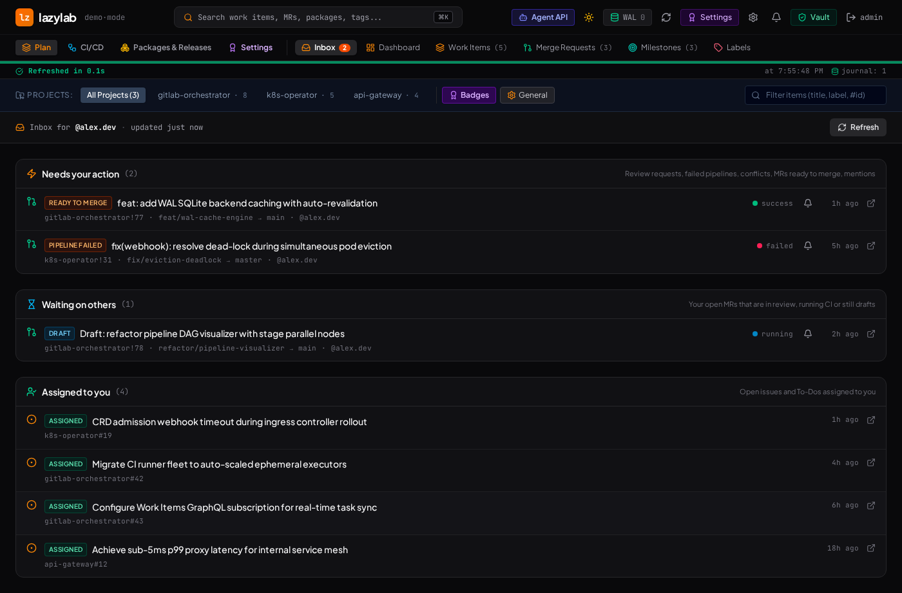
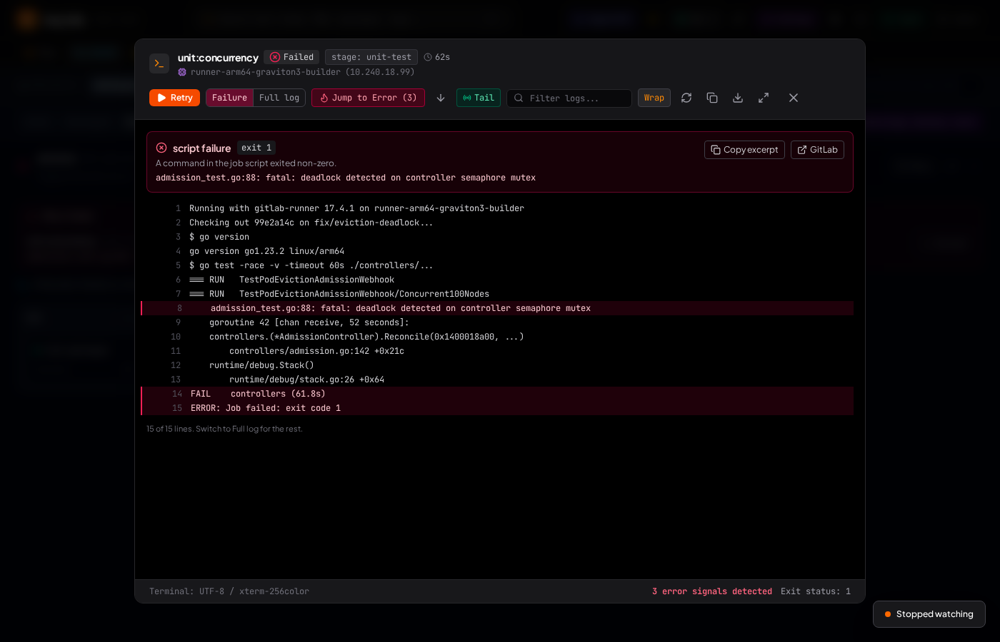

<p align="center">
  
</p>

<h1 align="center">lazylab</h1>

<p align="center">
  A self-hosted GitLab workspace that runs on your own machine, keeps your GitLab tokens in an encrypted vault, and tells you what needs your attention across projects, in the browser, on your phone, and in your coding agent.
</p>

<p align="center">
  <a href="LICENSE"></a>
  
  
  <a href="docs/src/agents/mcp.md"></a>
</p>

<p align="center">
  <a href="#quick-start">Quick start</a> ·
  <a href="docs/src/index.md">Documentation</a> ·
  <a href="docs/src/cli.md">Command line</a> ·
  <a href="docs/src/troubleshooting.md">Troubleshooting</a> ·
  <a href="CHANGELOG.md">Changelog</a> ·
  <a href="CONTRIBUTING.md">Contributing</a>
</p>



## Why lazylab

GitLab's own UI covers most single-project work. lazylab does what a hosted UI cannot, because it runs on your machine:

- **It sits next to your work.** `lazy` finds the project from your git remote, follows the pipeline after a push, and runs your app with the project's CI/CD variables.
- **It holds the secrets.** GitLab tokens stay in an encrypted vault; agents, scripts and your laptop get revocable lazylab tokens instead.
- **It looks across everything.** One inbox across every project you are a member of, instead of a tab per project.
- **It waits for you.** It watches pipelines, merge requests and token expiry, and notifies your browser or phone.

## Features

- **Inbox:** merge requests, issues and To-Dos from every member project that need you, sorted by who has to act next. Each one shows why: failed pipeline, merge conflicts, review requested, ready to merge.
- **Watches and push notifications:** follow a pipeline, job or merge request. You get a notification in the browser, through ntfy or Gotify on a phone, or through Slack and Discord webhooks when it finishes. Your own MR pipelines are watched automatically.
- **CI failure triage:** a failed job opens on the section of the log that failed, with the error line, exit code and failure reason. Failure notifications include that error line. Infrastructure failures are marked "likely passes on retry".
- **Run pipelines with variables:** variables declared in `.gitlab-ci.yml` are filled in, the last run is remembered, and the new pipeline is watched.
- **Planning:**
  - work items and merge requests with comments, labels, subtasks and attachments uploaded to GitLab;
  - approve, draft, merge, close and reopen merge requests;
  - milestones and labels across projects.
- **Releases:** release notes generated from Conventional Commits since the previous tag, with a suggested semantic version, and tag comparison.
- **Project settings:**
  - CI/CD variables (project and group, with bulk import and `.env` export);
  - badges, Pages and avatar;
  - a CI editor checked by GitLab's linter.
- **Encrypted vault:** GitLab profiles for several instances, CI secrets you can push to GitLab, runner tokens, other secrets and agent tokens. Everything is encrypted with a key derived from your password.
- **Token expiry:** warnings 14, 7, 3 and 1 days before a personal, project, group or deploy token expires, and rotation of a profile's personal access token from the vault.
- **Command line:** `lazy push` follows the pipeline after a push, `lazy job log --failed` prints the failure, `lazy mr create` opens the MR, and `lazy run` gives local commands the project's CI/CD variables.
- **Agents:** an MCP server at `/mcp` with 19 tools, and a REST API at `/api/agent`. Each uses revocable per-agent tokens; only tokens created with **Can read secrets** see the `get_env` tool. Agent skills for Claude Code, Codex and Antigravity are included.



## Quick start

| You need | For |
|---|---|
| Bun 1.3 or later, or Docker with Compose v2 | Running lazylab |
| A GitLab personal access token with the `api` scope | Live data; without one lazylab runs on sample data |
| Optional: the ntfy app or a Gotify server | Notifications on a phone |

### Bun

Requires Bun 1.3 or later. Shell: bash.

```bash
git clone https://gitlab.com/sgkens/lazylab.git && cd lazylab
cp .env.example .env
bun install
bun run build
bun run start                     # http://127.0.0.1:3000
```

### Docker

Requires Docker with Compose v2. Shell: bash, repository root.

```bash
cp .env.example .env
docker compose up -d --build      # http://127.0.0.1:3000
docker compose logs -f lazylab    # first start prints the setup code
```

### First run

1. Open the UI and enter the **setup code** from the server log. Only someone with console access can claim the instance.
2. Create the admin account. The password, 12 characters or more, encrypts the vault and **cannot be recovered**.
3. Add a GitLab host and a personal access token with the `api` scope, now or later under **Vault → GitLab profiles**.

Without a GitLab profile, lazylab runs on built-in sample data (demo mode). After every restart the vault is locked: sign in once to resume sync, watches and agent access.

## Connect a coding agent

Create a token in **Vault → Agent tokens**; the screen shows these commands with your URL and token filled in. Shell: bash, on the machine running the agent.

```bash
claude mcp add --transport http lazylab https://<your-host>/mcp \
  --header "Authorization: Bearer llab_..."
```

The agent can then:

- read your inbox;
- explain a failed pipeline with `get_pipeline_failures`;
- run a pipeline and have you notified when it finishes;
- file issues and merge requests.

See [MCP server](docs/src/agents/mcp.md) for Codex and the full tool list.

## Command line

`lazy` follows the pipeline after a push, prints why a job failed, opens merge requests from the last commit, and runs local commands with the project's CI/CD variables. It finds the project from the git remote. Shell: bash, repository root.

```bash
bun run cli:build && install -m 755 dist-cli/lazy ~/.local/bin/lazy
lazy login https://<your-host>        # agent token from Vault → Agent tokens
lazy push                              # push, then follow the pipeline; exit 1 if it fails
lazy job log --failed                  # failure excerpt of the latest failed pipeline
lazy mr create --draft                 # MR from the current branch
lazy run -- bun test                   # run with the project's CI/CD variables (token with "Can read secrets")
```

See [Command line](docs/src/cli.md).

## Use it from another machine

lazylab listens on `127.0.0.1` by default. To use it from a laptop, put it behind HTTPS: Tailscale Serve or Caddy (`LAZYLAB_TRUST_PROXY=loopback`), or the built-in TLS (`LAZYLAB_TLS=on`). Plain HTTP on a network address exposes your password and session cookie. lazylab warns about this at startup. See [Remote access](docs/src/remote-access.md).

## Documentation

The documentation site is in [`docs/`](docs/). It is built with Eleventy and Nunjucks, and the `pages` job in [`.gitlab-ci.yml`](.gitlab-ci.yml) publishes it with GitLab Pages when `docs/` changes on the default branch.

| Topic | Page |
|---|---|
| Install, first run, demo mode | [Getting started](docs/src/getting-started.md) |
| Common messages and fixes | [FAQ and troubleshooting](docs/src/troubleshooting.md) |
| Environment variables and data directory | [Configuration](docs/src/configuration.md) |
| HTTPS, proxies, certificates | [Remote access](docs/src/remote-access.md) |
| Vault encryption, sessions, tokens | [Security model](docs/src/security.md) |
| Inbox, notifications, CI, planning, releases, settings | [Guides](docs/src/guide/) |
| MCP, REST, skills | [Agents](docs/src/agents/) |
| `lazy` command line | [Command line](docs/src/cli.md) |
| Components, request path, watch loop | [Architecture](docs/src/reference/architecture.md) |
| What is verified against live GitLab | [Feature status](docs/src/reference/status.md) |
| Logo, colours, type | [Brand](docs/src/reference/brand.md) and [`brandkit/`](brandkit/) |

Build and preview the site. Shell: bash, repository root.

```bash
cd docs && bun install && bun run dev    # http://localhost:8090
```

## Security in brief

- One admin account. Sign-in is throttled after 4 failures per IP.
- The vault (`<data dir>/vault.json`) uses AES-256-GCM, with a data key wrapped by an scrypt-derived key. The key lives only in memory while you are signed in.
- Session cookies are `HttpOnly` and `SameSite=Strict`, and `Secure` over HTTPS. Every write must come from lazylab's own origin.
- Agent tokens are stored as SHA-256 hashes and can be revoked. They act as the active GitLab profile. Only tokens created with **Can read secrets** can read variable values and vault secrets.
- The GitLab response cache is not encrypted.

Details: [Security model](docs/src/security.md). To report a vulnerability, see [SECURITY.md](SECURITY.md).

## Project status

lazylab is pre-1.0 and built for a single user.

- The UI was audited in October 2026: every control now reaches a real GitLab call or says what it cannot do.
- Several features are verified only against demo data so far, including the inbox, run pipeline and release notes. [Feature status](docs/src/reference/status.md) lists what has run against a live GitLab.
- Open work is tracked in [devtracker-pending.md](devtracker-pending.md).

## Development

Shell: bash, repository root.

```bash
bun install
bun run dev      # API + Vite with reload
bun run lint     # tsc --noEmit
bun test         # unit tests
```

| Path | Contents |
|---|---|
| `server.ts` | Express entry point; Vite middleware in development, static `dist/` in production |
| `server/` | API routes, MCP server, GitLab client, vault, sessions, inbox, watches, notifications, triage, release notes, cache |
| `src/` | React 19 + Tailwind 4 single-page app |
| `tests/` | `bun test` suites |
| `cli/` | `lazy` command-line client |
| `skills/` | Agent skills for Claude Code, Codex and Antigravity |
| `docs/` | Documentation site (Eleventy) |
| `brandkit/` | Logo, colours and type; generated by `brandkit/build.mjs` |

Conventions:

- **Commits:** Conventional Commits (`type(scope): summary`), with `build: major|minor|patch` in the body when the version changes.
- **Branches:** feature branches merge into `develop`; `main` stays stable.

See [Development](docs/src/reference/development.md) for details and [CONTRIBUTING.md](CONTRIBUTING.md) before opening a merge request. Changes are listed in [CHANGELOG.md](CHANGELOG.md).

## License

[MIT](LICENSE)
