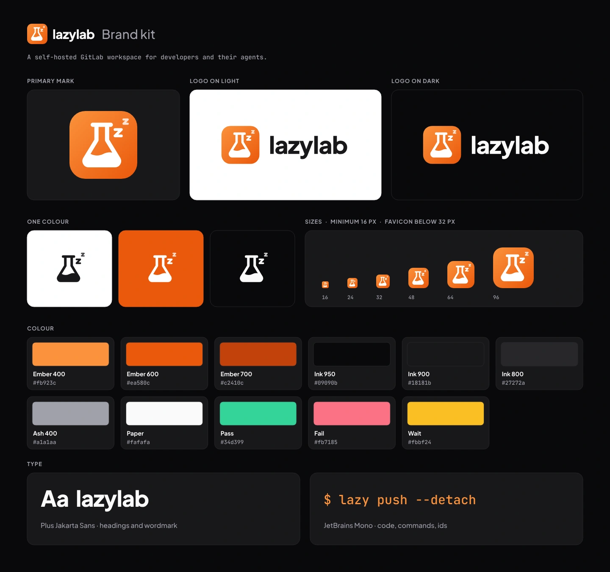

# lazylab brand

The lazylab logo, colours and type: the reference artwork, the config, and the files generated from them by [brandkit](https://gitlab.com/sgkens/brandkit).



Open [`index.html`](index.html) in a browser for the guide: logo files with downloads, clear space, colours, type and usage rules.

## The mark

A flask with a rising "zz" on an ember tile. The flask is the *lab*: GitLab, and a workbench on your own machine. The zz is the *lazy*: lazylab watches pipelines, tokens and merge requests so you do not have to. Write the name in lowercase, `lazylab`; the command-line client is `lazy`.

## What is here

| Path | Contents |
|---|---|
| `source/mark.svg` | The reference mark. Change the logo here |
| `source/glyph.svg` | The mark without its tile, for one-colour variants |
| `source/favicon.svg`, `source/touch.svg` | Favicon (one z) and the full-bleed home-screen icon |
| `brand.config.json` | Name, tagline, fonts, colours, theme, and where copies go |
| `svg/`, `png/`, `webp/`, `brand-sheet.svg`, `tokens.css`, `tokens.json`, `index.html` | Generated; do not edit |

The build also copies the mark, favicon and touch icon to `src/assets/brand/` (the app) and `docs/src/assets/brand/` (the docs site), and the link preview to the docs site.

## Rebuild

Edit `source/*.svg` or `brand.config.json`, then run brandkit. Requires Bun 1.3+ and a checkout of brandkit; see its README for setup.

```bash
# Shell: bash, repository root
brandkit build --config brand/brand.config.json
# or, without "bun link": bun /path/to/brandkit/src/cli.ts build --config brand/brand.config.json
```

Commit the regenerated files and the copies together.
