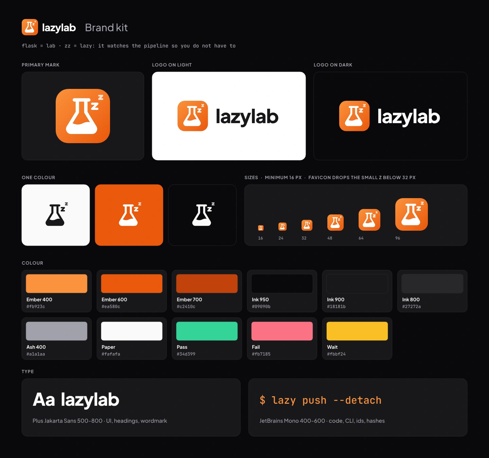

# lazylab brand kit

The lazylab logo, colours and type, generated from one script, with the copies the app and the documentation site use.



Open [`index.html`](index.html) in a browser for the full guide: logo files with downloads, clear space, colour swatches, type and usage rules.

## The mark

A flask with a rising "zz" on an ember tile. The flask is the *lab*: GitLab, and a workbench on your own machine. The zz is the *lazy*: lazylab watches pipelines, tokens and merge requests so you do not have to.

## Files

| File | Use |
|---|---|
| `svg/lazylab-mark.svg` | Primary mark: app header, avatars, README |
| `svg/lazylab-logo-light.svg`, `svg/lazylab-logo-dark.svg` | Mark and wordmark for light and dark backgrounds |
| `svg/lazylab-mark-ink.svg`, `svg/lazylab-mark-white.svg` | One-colour marks |
| `svg/lazylab-mark-flat.svg` | Mark without the gradient |
| `svg/favicon.svg`, `png/favicon-32.png` | Favicon (one z, for 32 px and below) |
| `svg/apple-touch-icon.svg`, `png/apple-touch-icon.png` | Full-bleed 180 px home-screen icon |
| `png/lazylab-mark-512.png`, `png/lazylab-mark-192.png`, `webp/lazylab-mark-512.webp` | Raster marks; the 512 PNG fits GitLab's 200 KB project avatar limit |
| `webp/lazylab-logo-light.webp`, `webp/lazylab-logo-dark.webp` | Raster logos, 192 px high |
| `svg/lazylab-social.svg`, `png/lazylab-social.png`, `webp/lazylab-social.webp` | 1280 × 640 link preview |
| `brandkit.svg`, `webp/brandkit.webp` | Overview sheet |
| `tokens.css` | Colour and font custom properties (`--ll-ember-600`, …) |

All text in the SVGs is converted to outlines, so they render the same without the fonts installed.

## Colour

| Token | Hex | Use |
|---|---|---|
| `ember-400` | `#fb923c` | Gradient start, accent on dark |
| `ember-600` | `#ea580c` | Gradient end, fills behind white icons (3.6:1 with white: not for small text) |
| `ember-700` | `#c2410c` | Accent and links on light (5.2:1 on white) |
| `ink-950` | `#09090b` | Background (dark) |
| `ink-900` | `#18181b` | Surfaces, wordmark on light |
| `ink-800` | `#27272a` | Borders on dark |
| `ash-400` | `#a1a1aa` | Muted text on dark |
| `paper` | `#fafafa` | Background (light), wordmark on dark |
| `pass`, `fail`, `wait` | `#34d399`, `#fb7185`, `#fbbf24` | Pipeline and job status only |

Type: Plus Jakarta Sans (interface, headings, wordmark at 800 with -2 % tracking) and JetBrains Mono (code and the CLI).

## Usage

- Use the files as supplied and scale them proportionally. Keep a quarter of the mark's width clear around it.
- Minimum size: 16 px for the mark, 24 px height for the logo. Below 32 px, use the favicon.
- Do not recolour, stretch, outline or add effects to the mark, and do not set the wordmark in another font or in capitals.
- Write the name in lowercase: `lazylab`. The command-line client is `lazy`.

## Rebuild

Every file is generated by [`build.mjs`](build.mjs) from the shapes, colours and fonts defined in it. Edit the script, not the outputs, then rebuild. The build also refreshes the copies in `src/assets/brand/` and `docs/src/assets/brand/`.

```bash
# Shell: bash, brandkit/
bun install && bun run setup    # once: fonts, opentype.js and Playwright's Chromium
bun run build
```

Fonts: Plus Jakarta Sans and JetBrains Mono, both under the SIL Open Font License, installed from Fontsource at build time.
