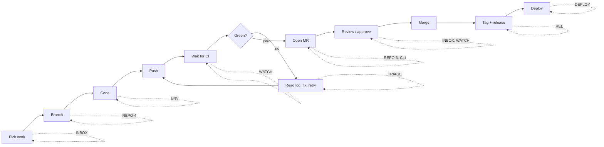
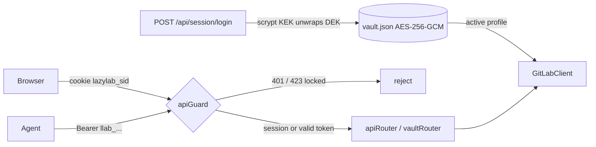
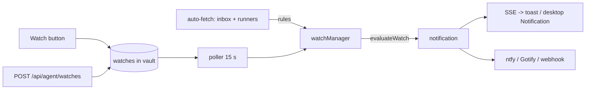
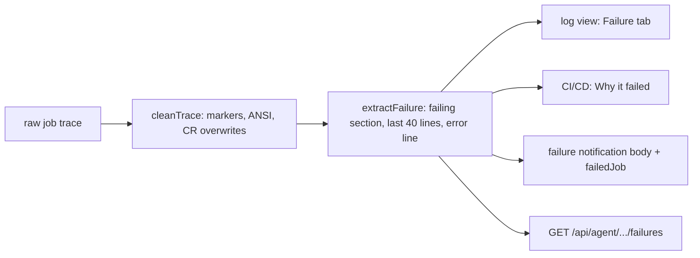
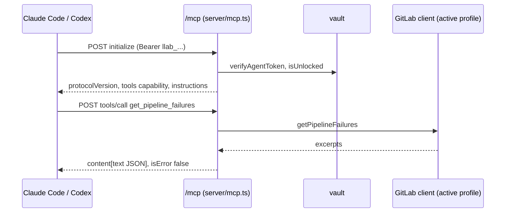
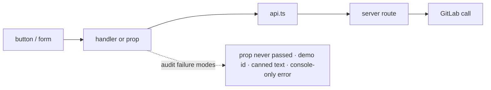
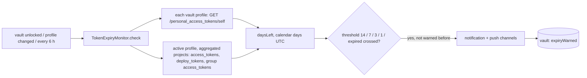
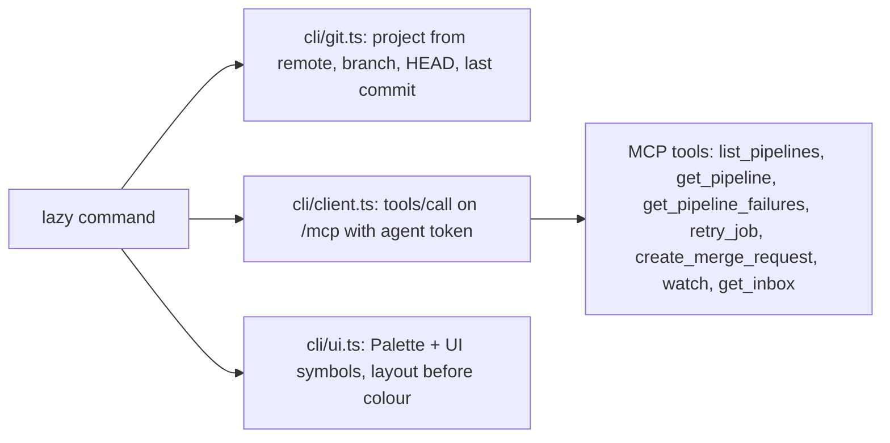
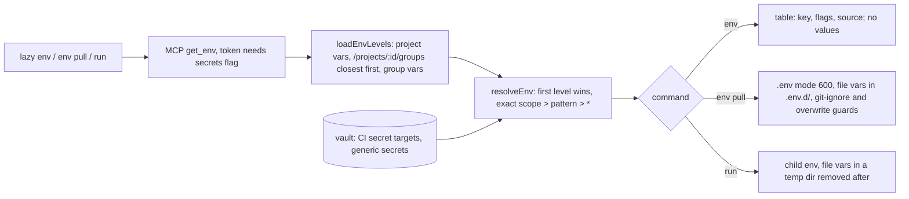

# lazylab dev tracker (pending)

Open epics and tasks for lazylab, plus the baseline audit of what is wired to GitLab and what is a stub, taken 2026-10-17 after import from Google AI Studio.

Status keys: `[ ]` open, `[~]` in progress, `[x]` done. Task IDs are `<epic>-<n>` and stay stable once assigned.

## Product audit: developer QoL (2026-10-17)

### Verdict

As imported, lazylab is mostly a second UI for things GitLab's own UI already does, and on its own that is not a reason for a developer to switch. lazylab becomes worth running when it does what a hosted UI cannot, because it runs on the developer's own machine:

1. **It sits next to the work.** The same host has the git checkouts, Docker, the runners and the editor. GitLab cannot see any of these.
2. **It holds secrets and brokers access.** Agents, scripts and the laptop get scoped lazylab tokens instead of a GitLab PAT with `api` scope.
3. **It aggregates and remembers.** It can show one view across every project and every GitLab host, kept in a local cache with "since you last looked" state.
4. **It can act on your behalf.** It can watch pipelines, retry infrastructure failures, notify the laptop or phone, and prepare releases.

Test for every new feature: does it remove a context switch or a repeated manual step, and does it need to run locally? If neither, it belongs in GitLab's UI rather than here.

### Where the developer loop loses time

| Step | Today without lazylab | lazylab answer |
|---|---|---|
| Pick work | Check To-Do list, MR lists and issue boards per project | INBOX: one list across projects and hosts |
| Branch | Copy the issue number by hand, type a branch name | REPO-4: start work on an issue |
| Code | Copy CI variables into `.env` by hand; secrets drift | ENV-1/2: pull or inject secrets from the vault |
| Wait for CI | Refresh the pipeline page, or forget about it | WATCH: notification on the laptop or phone when it finishes |
| Fix failures | Scroll a 5 MB log; retry flaky jobs by hand | TRIAGE: failure excerpt, flaky detection, retry policy |
| Open MR | Web form, copy the branch name | REPO-3 / CLI-1: MR from the current branch |
| Review | Email notifications, tab hunting | INBOX + WATCH: review queue, re-review on new push |
| Release | Work out the semver bump and write the changelog by hand | REL: bump and changelog from Conventional Commits |
| Deploy | Environments page per project | DEPLOY: environments across projects, review app cleanup |
| Across N projects | Repeat every setting change N times | FLEET: bulk labels, settings baseline, project bootstrap |
| Agents | Hand the agent a full-scope PAT | AGENT: MCP server, scoped tokens, approval queue |

### Integrations considered

| Integration | Verdict | Where |
|---|---|---|
| Notification push (ntfy, Gotify, generic webhook, browser Notification API) | Yes: covers phone, laptop and chat (Slack/Discord/Matrix incoming webhooks) with one mechanism | WATCH-2/3 |
| GitLab webhooks | Yes, optional: replaces polling when GitLab can reach the desktop (Tailscale Funnel, LAN self-hosted GitLab) | WATCH-5 |
| MCP (Model Context Protocol) | Yes: Claude Code and Codex connect natively instead of using the curl skill | AGENT-1 |
| Local git checkouts | Yes: branch, ahead/behind and pipeline status for local HEAD | REPO |
| Editor deep links (`vscode://`, `cursor://`, JetBrains) | Yes: little effort, removes "find that file" steps | REPO-5 |
| Docker on the host | Opt-in only (socket access is root-equivalent): local runner lifecycle | RL-2 |
| Container registry | Yes: storage cleanup is a recurring chore | REG |
| Renovate / Dependabot MRs | Yes: group and bulk-merge across projects | FLEET-4 |
| Jira / Linear | No for now: GitLab work items cover it; revisit if asked | n/a |
| Hosted LLM in the app | No: the mission is local-first. Agents are reached through MCP and skills instead | AGENT |
| Sentry / uptime | Later: link releases to errors once REL and DEPLOY exist | n/a |

### Non-goals

- Full diff and code review UI: GitLab's review UI is the right tool there. lazylab links to it and adds queue, state and notifications around it.
- Wiki, snippets, epics, boards editing.
- Being a multi-user server: lazylab has one owner and many devices.

### Roadmap

1. **Foundation, blocks everything else:** GL-1, GL-14, GL-15, GL-2, CACHE-1/2/4, BUILD-3. Cross-project views are wrong while list calls hit non-existent endpoints and swallow errors.
2. **First differentiators, most QoL for the effort:** ~~INBOX-1/2~~, ~~WATCH-1..4~~, ~~TRIAGE-1/6~~, ~~ENV-4~~, ~~AGENT-1~~.
3. **Away from the browser:** ~~CLI-1/2~~, CLI-4, ~~ENV-1/2~~, REPO-1..4.
4. **Chores at scale:** REL, FLEET, DEPLOY, REG, RL.

## Audit baseline (2026-10-17)

Classification of the live (token configured) code path. With no token everything runs on in-memory demo data in `server/gitlabClient.ts`, and mutations are lost on restart.

- **WIRED**: calls the correct GitLab REST v4 endpoint, and the result reaches the UI correctly.
- **PARTIAL**: calls GitLab but has a defect, an invalid endpoint, or a fabricated fallback.
- **STUB**: no real implementation in live mode.
- **DEMO**: exists only for the demo/visual layer.

### Server: GitLab features

| Area | Feature | Status | Notes |
|---|---|---|---|
| Auth | verify / save / clear token | WIRED | Since 2026-10-17 (second pass), save/clear create/deactivate an encrypted vault profile |
| Sync | auto-fetch timer + SSE `/api/events` | WIRED | Since 2026-10-17 (third pass): fans out over the 15 most recently active member projects and refreshes the per-project cache keys; also refreshes the inbox |
| Projects | list | WIRED | Capped at 50, no pagination |
| Projects | update settings | WIRED | |
| Projects | avatar upload | WIRED | Seventh pass: multipart `PUT /projects/:id`; 200 KB limit checked in the UI |
| Milestones | list | WIRED | Third pass: per-project fan-out; active milestones only; counts from `issues_statistics`, "n/a" when unavailable |
| Milestones | create | WIRED | |
| Work items | list | WIRED | Capped at 50 per project. All-projects view fans out over member projects (was `/issues?scope=all`, which includes every public project on gitlab.com) |
| Work items | create / update | WIRED | Seventh pass: results mapped; empty strings kept; milestone 0 unassigns |
| Work items | subtasks (checkbox lines) | PARTIAL | IDs are positional (an added subtask now gets its position). Toggle returns `[]`; the drawer's description is not refreshed after a toggle |
| Notes | list / create (issues and MRs) | WIRED | |
| Notes | attachments | WIRED | Seventh pass: `POST /api/projects/:id/uploads` (raw body, 10 MB) proxies to GitLab `/projects/:id/uploads`; GitLab's relative Markdown link does not render in lazylab's own preview |
| MRs | list | PARTIAL | `approved` = approved by me, from one `approved_by_usernames[]` call per project (seventh pass). List responses carry no pipeline; only the inbox fetches single MRs for `head_pipeline` |
| MRs | approve / unapprove / merge | WIRED | |
| MRs | update | WIRED | Seventh pass: `draft` sets or strips the `Draft:` title prefix; result mapped |
| MRs | create | WIRED | Agent API, MCP and Agent access → Try it; no dedicated form |
| Pipelines | list | WIRED | Third pass: per-project fan-out, newest 50 |
| Pipelines | jobs, retry, cancel, play job, run with variables | WIRED | Fifth pass: `POST /projects/:id/pipeline`; job retry uses `/jobs/:id/retry` (the log view used `play`, which only works on manual jobs) |
| Jobs | trace, failure excerpt | WIRED | Whole log per request (tail capped at 2 MB), no incremental tail; errors are masked as a fake trace. Failed jobs return a failure excerpt with the trace |
| Runners | list | WIRED | `/runners` returns only runners the user owns, not the admin `/runners/all` |
| Runners | pause, assign, unassign, delete, runner jobs | WIRED | |
| Runners | register | WIRED | Fixed in the second pass (GL-6): uses the returned token, saves it to the vault, surfaces API errors |
| Labels | list | WIRED | Third pass: per-project fan-out, de-duplicated by name; project scope uses `with_counts=true` |
| Labels | create | WIRED | |
| Packages | list | WIRED | Third pass: per-project fan-out |
| Packages | details | WIRED | Server and client function exist, but no UI calls them |
| Tags / releases | list / create | WIRED | Not yet exercised against a live instance |
| CI editor | read `.gitlab-ci.yml` | WIRED | Seventh pass: default branch or a given ref; 404 = empty with a notice; other errors are shown, never sample YAML |
| CI editor | save | WIRED | Real commit id; a new branch is created from the default branch; unchecking Run pipeline adds `[skip ci]` |
| CI editor | lint | WIRED | Local parser per keystroke for the graph; GitLab `/projects/:id/ci/lint` after a pause decides validity |
| Variables | list / save / delete | PARTIAL | Group scope uses the project namespace (seventh pass). Save does POST, then PUT on *any* error. Masked values are returned to the browser |
| Badges | list / create / delete | WIRED | Seventh pass: explicit id required; group badges use the project namespace |
| Badges | pipeline-setup preset | WIRED | Seventh pass: URLs from the project's `web_url`; release badge `/-/badges/release.svg`; preview and copied Markdown use the real URLs |
| Pages | info | WIRED | Seventh pass: deployments, `force_https`, `pages_access_level`; 404 = not deployed; unknown values labelled. Update sends `pages_https_only`; redeploy runs a watched pipeline |
| Pages | update | WIRED | |

### Server: infrastructure

| Component | Status | Notes |
|---|---|---|
| `cacheDb` | PARTIAL | TTL enforced since the third pass (`get(key, { allowStale })` keeps expired rows for offline use). The "WAL" is an append-only JSON-lines file, not SQLite WAL. The whole sql.js DB is exported to disk on each write batch. Journal file and `wal_logs` table grow without bound |
| `metricsManager` | WIRED | Seventh pass: starts at zero with an empty 30-minute window |
| `/api/metrics/simulate-hit` | REMOVED | Seventh pass |
| Error handling | PARTIAL | Most list calls swallow errors and return `[]`, so the UI cannot tell an empty result from a failure |
| Agent API `/api/agent/*` | WIRED | Defaults to the first project when `projectId` is omitted. `GET /:iid` reads the item directly (seventh pass). `skill.md` is served from `skills/` (single copy) |

### Frontend

| Area | Status | Notes |
|---|---|---|
| All views call `src/services/api.ts` → `/api/*` | WIRED | No direct GitLab calls from the browser |
| Sync progress bar | WIRED | Seventh pass: indeterminate bar with elapsed time |
| Global search (Ctrl+K) | WIRED | Client-side filter over loaded data; work items and MRs open their drawers; settings results open the right section |
| External assets | — | Google Fonts, Unsplash avatars in demo data, and shields.io all need network access |
| Bundle | — | Single 549 kB JS chunk |

## Done this session (2026-10-17)

- [x] Removed Gemini / AI Studio: `@google/genai` dependency, `metadata.json`, AI Studio README, `APP_URL` env, `DISABLE_HMR` config
- [x] Removed unused deps: `motion`, `ws`, `@types/ws`, `dotenv` (Bun loads `.env`), `tsx`, `esbuild`, `autoprefixer`; build-only deps moved to `devDependencies`
- [x] Bun on metal: `bun run dev` (watch) and `bun run start` (production)
- [x] Docker: multi-stage `Dockerfile` (oven/bun, non-root, `/data` volume), `compose.yaml` publishing on `127.0.0.1` only, `.dockerignore`
- [x] Bind `HOST` defaults to `127.0.0.1`; `LAZYLAB_DATA_DIR` env for the cache location
- [x] Vite is imported only in dev, so the production image runs without it
- [x] Fixed dev double-mount: `vite.config.ts` also mounted `apiRouter`, which created two cacheDb instances and two auto-fetch timers writing the same files
- [x] `skills/.claude`, `skills/.codex`, `skills/.antigravity` with the `lazylab-agent` skill; removed `SKILL_LAZYLAB_AGENT.md`
- [x] Verified: `tsc --noEmit` clean, `vite build` OK, `bun run start`/`dev` serve the SPA and API, `docker build` + `docker run` serve the SPA and API

## Done 2026-10-17 (second pass): authentication + vault

Scope change: lazylab runs on the desktop and is used from a laptop, so it needs login, an encrypted secrets store and HTTPS. Decisions:
- **Vault unlock:** login password only (no keyfile auto-unlock).
- **Transport:** built-in TLS plus proxy support.
- **Vault contents:** GitLab profiles, CI secrets, runner tokens, generic secrets.

- [x] AUTH-1 First-run setup with a setup code printed to the server log; single admin account
- [x] AUTH-2 Vault `server/vault.ts`: scrypt(N=2^16) KEK → wrapped random DEK → AES-256-GCM payload. Atomic `0600` writes. Locked after restart
- [x] AUTH-3 In-memory sessions, HttpOnly + SameSite=Strict (+Secure over HTTPS), 12 h idle / 7 d absolute
- [x] AUTH-4 Origin check on mutating requests (was SEC-2), `LAZYLAB_PUBLIC_HOSTS` for Host-rewriting proxies
- [x] AUTH-5 Login and setup throttling per IP (5 free attempts, then exponential up to 15 min)
- [x] AUTH-6 Lock vault (wipes key, signs out every device, stops sync); change password (re-wraps DEK); signed-in devices list
- [x] AUTH-7 GitLab profiles in the vault; multiple hosts; activate/deactivate; `GITLAB_TOKEN` imported once at setup (was SEC-3)
- [x] AUTH-8 CI secrets with push to project/group variables, push targets recorded
- [x] AUTH-9 Runner tokens saved automatically on registration (with GL-6 fix)
- [x] AUTH-10 Agent bearer tokens (`llab_…`, SHA-256 stored); `/api/agent/*` returns 401 or 423; skills updated for `LAZYLAB_URL` / `LAZYLAB_TOKEN`
- [x] AUTH-11 Built-in HTTPS (`LAZYLAB_TLS`), self-signed cert with SANs + logged fingerprint, or your own cert; `LAZYLAB_TRUST_PROXY`
- [x] AUTH-12 Security headers (nosniff, frame DENY, no-referrer); plain-HTTP-on-LAN startup warning (was SEC-5)
- [x] AUTH-13 UI: setup/login screen, Vault view (profiles, CI secrets, runner tokens, secrets, agent tokens, account), sign-out
- [x] Verified:
  - curl flow (setup, login, throttle, origin rejection, reveal, agent token, restart → locked/423, password change, lock)
  - Container with TLS
  - Headless Chromium UI flow (setup → vault → add/reveal secret → agent token → sign out → sign in), no page errors

## Done 2026-10-17 (third pass): foundation + inbox

- [x] GL-1 Removed the non-existent global endpoints. `forRecentProjects` fans out over the 15 most recently active member projects (4 in flight) for milestones, pipelines, labels, packages, work items and MRs
- [x] GL-14 Milestone counts from `issues_statistics`; the UI shows "n/a" instead of the fake 60%
- [x] CACHE-2 TTL enforced in `cacheDb.get`; `allowStale` for later offline use (CACHE-5)
- [x] CACHE-4 Auto-fetch now refreshes the per-project keys the views read
- [x] INBOX-1 `GET /api/inbox` and `GET /api/agent/inbox` (`server/inbox.ts`): review requests, own MRs with `head_pipeline`, assigned issues, To-Dos merged onto items; partial failures reported in `errors[]`
- [x] INBOX-2 Inbox is the default tab, grouped into action / waiting / assigned, with an action count badge in the nav
- [~] BUILD-3 `bun test` set up (`tests/`, `bunfig.toml` preload isolates `LAZYLAB_DATA_DIR`): `mapLimit`, cache TTL, inbox classification and assembly, demo inbox. Still to cover: `yamlParser`, normalisers, routes
- Verified: `tsc`, `vite build`, 19 tests, headless Chromium flow (setup → inbox → milestones → dashboard → vault → agent token → sign out → sign in), no page errors

Follow-ups found on the way:
- [ ] INBOX-7 "Already approved by me" state for review requests (needs `/merge_requests/:iid/approvals` per item)
- [ ] GL-17 Make `AGGREGATE_PROJECT_LIMIT` (15) a setting, or let the user pin the projects the all-projects views aggregate
- [ ] GL-18 MR list pipeline status for the MR view (single-MR fetch or `/pipelines?ref=`) — list responses have none

## Done 2026-10-17 (fourth pass): watches and notifications

- [x] WATCH-1 Watches on pipelines, jobs and MRs (`server/watch.ts`): 15 s poller; pipelines/jobs end on a terminal state (incl. `manual`), MRs on merged/closed and notify on conflicts and finished head pipelines. Stored in the vault per GitLab profile; 404 removes the watch
- [x] WATCH-2 SSE `notification` / `watches_changed`; toast in the foreground, desktop `Notification` when the tab is hidden; bell menu with history and active watches
- [x] WATCH-3 Push channels in the vault: ntfy (JSON publish, bearer token), Gotify (`X-Gotify-Key`), webhook (`json` / `slack` / `discord`); all or failures only; test send; delivery health
- [x] WATCH-4 Rules: auto-watch running pipelines of my MRs, new review requests, new commits on MRs I review, runner offline / back online. First refresh after unlock is a silent baseline
- Agent API: `GET/POST /api/agent/watches`
- Verified: 34 tests (wire formats, evaluation, manager with a real vault), curl end-to-end against a capture server (formats, failures-only filter, masking, agent bearer, restart persistence), headless Chromium (watch toggle, bell menu, add channel), no page errors

Follow-ups:
- [ ] WATCH-7 Snooze / mute a watch or rule for N hours; quiet hours for push channels
- [ ] WATCH-8 Notification history survives restart (today in memory, cleared on lock)
- [ ] WATCH-9 MR watch: notify on new approvals and new comments (needs notes polling)
- [ ] WATCH-10 Poll interval setting; back off on GitLab rate-limit headers

## Done 2026-10-17 (fifth pass): CI failure triage and run pipeline

- [x] TRIAGE-1 `server/triage.ts`: parses `section_start`/`section_end`, skips post-script runner sections, keeps the last 40 lines of the failing section, highlights error lines, picks an `errorLine` (cause lines such as `error:`/`fatal` before summary lines such as `1 fail`), exit code, `failure_reason` hint and `retryable`
  - Log view opens on a Failure tab for failed jobs (copy excerpt, GitLab link); the trace response carries the excerpt so the log is fetched once
  - CI/CD: failed pipelines list each failed job's error line (allowed failures excluded)
  - Watch failure notifications append `job: error line` and carry `failedJob`; "Why it failed" in the bell and a click on the desktop notification open the excerpt
- [x] TRIAGE-6 Run pipeline: ref with branch suggestions, variables prefilled from GraphQL `ciConfigVariables` (descriptions, option lists), last run per project in localStorage, watch by default. Variables left at the declared default are not sent
- Fixed: the log view's Retry called `play` (manual jobs only); finished jobs now use `/jobs/:id/retry` and the new job is watched and opened
- Agent API: `POST /api/agent/pipelines`, `GET /api/agent/pipelines/:id/failures`, `GET /api/agent/jobs/:id/failure`
- Verified: 49 tests (trace parsing on runner-shaped traces, nested sections, CR progress, window cap, input validation, enriched notification through the manager), curl end-to-end in demo mode (excerpt, failures, branches, declared variables, run, validation errors, cross-origin rejection, retry, ntfy body with the error line, agent bearer), headless Chromium (Why it failed, Failure tab, run form with an option variable), no page errors
- Not verified against live GitLab: `ciConfigVariables` (GraphQL field availability varies by version), `/jobs/:id/retry` response, trace section markers from a real runner

Follow-ups:
- [ ] TRIAGE-8 Run pipeline from the Inbox and from an MR row (prefill the source branch)
- [ ] TRIAGE-9 Excerpt for very large logs without downloading the whole trace (needs TRIAGE-5 offset fetch)
- [ ] TRIAGE-10 Show failures for jobs in child/downstream pipelines (bridges)

## Done 2026-10-17 (sixth pass): MCP server

- [x] AGENT-1 `server/mcp.ts`: stateless Streamable HTTP (POST JSON, GET/DELETE 405, notifications 202, batches for 2025-03-26), protocol versions 2025-06-18 / 2025-03-26 / 2024-11-05, bearer agent tokens, Origin check, 503 while locked
  - 17 tools: inbox, projects, work items (list/get/create/update), comments, MRs (list/get/create), pipelines, pipeline and job failures, run pipeline, retry job, watch, list watches
  - Tools accept a project id or `group/project` path; outputs are trimmed to the fields an agent uses; read-only tools are annotated
  - Argument validation against each tool's input schema; bad arguments and GitLab errors come back as tool errors (`isError`) so the model can correct itself
  - `GitLabClient.getWorkItem` reads one issue directly instead of searching the first 50
- [~] AGENT-5 Vault → Agent tokens shows Claude Code, Codex and REST setup after creating a token (skill install not generated)
- Verified: 61 tests (protocol, version negotiation, validation, tools against demo data); the official MCP TypeScript SDK client (1.17.0) connected over HTTP, listed and called tools; curl for 401 without or with a bad token or cookie only, 403 foreign Origin, 405 GET, 202 notification, batch, 400 empty body, 503 locked; headless Chromium for the setup snippets
- Not verified: Claude Code and Codex end to end (the Codex `bearer_token_env_var` config key is from Codex docs, not tested here); live GitLab for the new single work item read

Follow-ups:
- [ ] AGENT-6 MCP resources: job logs and `.gitlab-ci.yml` as readable resources (feeds TRIAGE-7)
- [ ] AGENT-7 Per-token tool allowlist (part of AGENT-2 scopes)

## Done 2026-10-17 (seventh pass): UI audit and documentation site

Method: every API client call checked against a server route; every component prop checked for a caller; every handler read for hardcoded ids, timers standing in for work, and swallowed errors.

Fixed (UI-reachable):
- [x] AUDIT-1 Agent access modal was imported but never rendered; Navbar, Dashboard and search entry points were hidden. Rewritten with MCP, REST, Skill (from `/api/agent/skill.md`) and Try it (explicit project, real-item warning, real result)
- [x] AUDIT-2 Dashboard `onOpenBadges`/`onOpenGeneral` and search `onSelectMR`/`onSelectSettingsSection` were never passed; search forced the badges section
- [x] AUDIT-3 MR view received `onUpdateLabels` and `onToggleState` but never called them; drawer went stale after list updates
- [x] AUDIT-4 Work item labels could be removed but not added
- [x] AUDIT-5 Attachments inlined as base64 → GitLab uploads
- [x] AUDIT-6 CI editor "Trigger pipeline" and Pages "Re-deploy" retried demo pipeline 30101
- [x] AUDIT-7 Releases "Auto-generate" inserted canned text; tag compare showed a fixed sentence → `server/releaseNotes.ts` (Conventional Commits, semver suggestion)
- [x] AUDIT-8 Badge modal previews and copied Markdown used fake shields.io values; preset used gitlab.com
- [x] AUDIT-9 Group variables/badges hardcoded group 101; several views fell back to project 901
- [x] AUDIT-10 Dashboard simulator wrote fake metrics; metrics seeded with fake totals
- [x] AUDIT-11 Sync bar percentage was timer-driven
- [x] AUDIT-12 20 handlers only logged errors → `utils/reportError` toast
- [x] AUDIT-13 Vault page left a nav group highlighted
- [x] AUDIT-14 `.dockerignore` excluded `skills/` (needed by `skill.md`); docs and tests now excluded instead

Docs:
- [x] DOCS-1 Eleventy 3 + Nunjucks site in `docs/` (own `package.json`): 18 pages, Mermaid, light/dark, mobile nav, pager, edit links, `DOCS_PATH_PREFIX` for Pages
- [x] DOCS-2 README rewritten as a project landing page that links into the docs

Verified: 66 tests; headless Chromium audit flow (agent modal, dashboard, search → MR drawer, MR labels/approve/close, work item label, release notes, tag compare, CI editor lint source); earlier UI and triage flows; curl for uploads (413 over 10 MB), skill.md, badge id validation, release notes, removed simulator (404); docs link check (0 broken), screenshots at desktop and 390 px.

Follow-ups:
- [x] AUDIT-15 Server list calls swallowed errors and returned `[]` → list reads throw; auto-fetch refreshes sources independently; App loads each source on its own and names the failed ones; group variables/badges failures no longer hide project rows; job trace no longer returns a placeholder log
- [x] AUDIT-16 Masked variable values reached the browser → redacted in list, save response and SSE (`server/variables.ts`); `GET /api/variables/value` reads one on Reveal/Copy/Clone (no-store, journaled); export comments them out; PUT targets the environment scope
- [x] AUDIT-17 Work item drawer description not refreshed after a subtask toggle → toggle/add return the updated item; failed toggle reverts; comments no longer reload on every item update
- [x] AUDIT-18 Settings modal duplicated Vault → GitLab profiles → modal is connection summary + refresh settings with a link to the vault; `/auth/verify|save|clear` removed
- [x] DOCS-3 `.gitlab-ci.yml`: `docs:build` on MRs, `pages` on the default branch; prefix derived from `CI_PAGES_URL`
- [x] DOCS-4 MIT `LICENSE`; `license` in both package.json files; README and development page link it

## Done 2026-10-17 (eighth pass): token expiry (ENV-4)

- [x] ENV-4a `server/tokenExpiry.ts`: `daysLeft`, `thresholdFor`, `dueWarnings`, `TokenExpiryMonitor` (unlock, profile change, 6 h timer, shared in-flight run)
- [x] ENV-4b Client: `getPersonalAccessTokenSelf`, `rotatePersonalAccessTokenSelf`, `getResourceTokens` (403/404 skipped as "not a maintainer"; other failures listed)
- [x] ENV-4c Warnings once per threshold, remembered in the vault (`notify.expiryWarned`, pruned to live tokens); new rule `tokenExpiry` (default on); failure level at 3 days or less
- [x] ENV-4d `GET /api/tokens/expiry`, `POST /api/tokens/personal/:profileId/rotate` (future date required; new token saved before anything else; if the vault save fails the response carries the new token and the UI shows it with a copy button)
- [x] ENV-4e Vault → GitLab profiles: expiry badge per profile, Rotate form with expiry date; Token expiry card for project, group and deploy tokens with links to GitLab

Verified: 79 tests (thresholds, calendar-day counting, warn-once, rule off); headless Chromium in demo mode (overview, warning text, rotate validation 400/404, card and badges, Check now, rule toggle); rotation end to end against a fake GitLab that revokes the old token (3-day warning at failure level, rotate in the UI, vault holds the new token, active client still authenticates).
Not verified: live GitLab (`/personal_access_tokens/self` needs 16.0+, rotate 16.10+); the vault-save-failure rescue path.

Follow-ups:
- [ ] ENV-6 Rotate project and group access tokens (`POST /projects/:id/access_tokens/:token_id/rotate`) and update vault CI secrets that hold them
- [ ] ENV-7 MCP tool `get_expiring_tokens` so agents can report expiring tokens
- [ ] ENV-8 Expiry for tokens stored as vault entries (runner tokens, CI secrets) where GitLab exposes it

### Errors noted this pass

| # | Error | Cause | Status |
|---|---|---|---|
| E1 | Browser check expected "5d left" for a token expiring 5 calendar days out, got 4 | `daysLeft` counted hours to 00:00 UTC on `expires_at`, not calendar days as GitLab shows them | Fixed: calendar days; `expires_at` today counts as expired |
| E2 | Follow-up browser flow failed on 3 console errors | The flow's own probes of the removed `/api/auth/*` routes logged expected 404s | Fixed in the test: errors checked before the probes and cleared after |
| E3 | AUDIT-15 test: `getMergeRequests` resolved instead of rejecting | The first pass removed `catch {}` blocks but missed a `catch (err) { console.error; return [] }` variant | Fixed; remaining catches reviewed (404 handling, lint fallback, GraphQL fallback are intended) |
| E4 | `git merge` on WSL: `fatal: stash failed` | Auto-stash on the `/mnt/g` filesystem fails intermittently | Workaround: `-c merge.autoStash=false` and retry; merge succeeds |
| E5 | Container logs the plain-HTTP warning with the default loopback port mapping | Inside the container the server listens on `0.0.0.0` | Open: suppress when `LAZYLAB_IN_CONTAINER` is set and the published port is loopback-only, or reword |
| E6 | Tracker listed done work as open (GL-3..16, UI-1/2/3/5, BUILD-7, REL-1/2, SEC-4) | Earlier passes recorded fixes in their own sections only | Fixed: items ticked with a note where the result differs from the original plan |

## Done 2026-10-17 (ninth pass): `lazy` command line (CLI-1, CLI-2)

- [x] CLI-1a `cli/lazy.ts` entry: argument parser, help, `login` (verifies with `tools/list`, config file mode 600, env override), exit codes 0/1/2/130
- [x] CLI-1b Commands: `inbox`, `ci`, `ci watch`, `job log <id>`, `job log --failed`, `retry [--follow]`, `mr create` (title/body from last commit, `Closes #N` from `N-slug` branches, `--draft`, `--label`, `--watch`)
- [x] CLI-2 `lazy push`: pushes the branch under its own name (`-u` on first push), finds the pipeline for HEAD, asks lazylab to watch it, follows it unless `--detach`; Ctrl+C keeps the lazylab watch
- [x] New MCP tool `get_pipeline` (status of each job) for following; `retryJob` returns `pipeline_id`
- [x] `package.json` `bin` and `cli:build` (compiled binary in `dist-cli/`, ignored by git and Docker)

Verified: 88 tests (remote parsing, branch issue numbers, MR text, argument parsing, column layout); end to end against a fake GitLab whose pipelines progress over time and are created by a post-receive hook: push follows a failing pipeline and exits 1 with the excerpt, `job log --failed`, `retry --follow` reaches success, `mr create --draft --label` sends the right title, description and labels, `push --detach`, `ci watch`, push without a pipeline stops after the timeout, unknown pipeline and unknown command errors, watches finish and notify; compiled binary runs.
Not verified: live GitLab; macOS and Windows binaries; `lazy login` token prompt on a real TTY (tested with `--token`).

Follow-ups:
- [ ] CLI-5 `lazy open` (MR or pipeline of the current branch in the browser) and `lazy mr status`
- [ ] CLI-6 Shell completions (bash, zsh, fish)
- [ ] CLI-7 Release the binaries from CI for Linux, macOS and Windows (with BUILD-4)

### Errors noted this pass

| # | Error | Cause | Status |
|---|---|---|---|
| E7 | `lazy push` on a branch created from `origin/main` ran a plain `git push`, which git refused (exit 128) | `branch.autoSetupMerge` makes the new branch track `origin/main`; any upstream was taken as "already pushed" | Fixed: `pushedRemote()` accepts only an upstream with the branch's own name; `mr create` uses the same check |
| E8 | A demo "release-bot expires in 5 days" warning was sent while connected to a real (fake) GitLab | The expiry check at unlock ran before the profile was active and warned about demo sample tokens; warnings reach real push channels | Fixed: demo tokens are listed but never warned about; unit test uses a live-like stub |
| E9 | `lazy ci watch 99999` printed "Not watched in lazylab" and then the 404 | The watch was added before checking that the pipeline exists | Fixed: `get_pipeline` first, then watch |
| E10 | First end-to-end run created a branch from a local `main` that did not exist | Test script bug (`main` only existed on the remote) | Fixed in the script (`origin/main`) |
| E11 | "Auto-fetch background error: Unable to connect" at the end of the run | The script stops the fake GitLab and lazylab together | Expected; not a product error |
| E12 | Pipeline-finished notifications missing from the first run's check | Watches poll every 15 s and the script ended sooner | Script waits for one poll; notifications arrive |

## Done 2026-10-18 (tenth pass): local environment (ENV-1, ENV-2)

- [x] ENV-1a `server/envResolve.ts`: `scopeMatches` (GitLab `*` wildcards), `resolveEnv` (project > closest group > parent; exact > pattern > `*`; hidden values from the vault CI secret pushed to the same key and scope; named vault secrets win), `loadEnvLevels` (a group the user cannot read is skipped and reported)
- [x] ENV-1b Client: variables read all pages (was the first 20 only, which also affected the Variables view); `hidden` flag (GitLab 17.4+, value `null`); `getProjectAncestorGroups`; demo group variables filtered by group id (the demo showed platform's variables for every group)
- [x] ENV-1c MCP tool `get_env`, listed and callable only for agent tokens created with **Can read secrets** (new `AgentToken.secrets`); each call is journaled as `READ_ENV` with the token name. First slice of AGENT-2/SEC-6
- [x] ENV-1d Vault → Agent tokens: "Can read secrets" checkbox at creation, "reads secrets" badge
- [x] ENV-1e `lazy env` (keys, flags, source; `--json` without values) and `lazy env pull` (`--env`, `--out`, `--secret KEY=name`, `--force`; refuses files git does not ignore and a `.env` it did not write; file variables in `<out>.d/`)
- [x] ENV-2 `lazy run [--env] [--secret] -- <cmd>`: variables in the child environment only, file variables in a private temp dir removed afterwards, exit code passed through (128 + signal)
- [x] Defaults from `git config lazylab.environment` and `lazylab.secret` (multi-valued); repeated string options join into a comma list

Verified: 104 tests (scope matching, precedence, specificity, vault fallback, named secrets, quoting, rendering, caveats, argument parsing, `get_env` gating and demo resolution, token flag); end to end in demo mode (plain token refused; list; pull refused without `.gitignore`, then for `.env.d/`; production pull with a secret and a missing one; modes 600/700; `run` with a file variable, exit 3 passed through, temp dir removed; `run` without `--`, unknown command; hand-written `.env` refused, `--force`; git config defaults; journal entries); headless Chromium (checkbox, badge, stored flag, no console errors); `.env` quoting checked against Node `--env-file`, Bun and Docker Compose.
Not verified: live GitLab (`/projects/:id/groups`, hidden variables, pagination past 100, 403 on a parent group); Windows (`chmod`, temp dir, signals).

Follow-ups:
- [ ] ENV-9 `lazy env diff`: compare the local `.env` with what `env pull` would write (keys added, removed, changed; no values)
- [ ] ENV-10 Expand `$NAME` references between variables the way GitLab does for non-raw variables
- [ ] ENV-11 Per-token project allowlist for `get_env` (with AGENT-2)

### Errors noted this pass

| # | Error | Cause | Status |
|---|---|---|---|
| E13 | A value with `$HOME` in single quotes came back expanded under `bun --env-file` | Bun's loader expands `$NAME` even in single quotes; Node, dotenv and Compose read single quotes literally | Kept single quotes (literal for most loaders); `env pull` names the keys with `$` and points to `lazy run` |
| E14 | Double-quoted `\"` escapes came back with the backslash under Node `--env-file` | Node does not unescape `\"` | Double quotes are used only for values with `'` and no `"` or `\`; values with both quote kinds are named as not portable |
| E15 | `resolveEnv` test failed: `SONAR` was null | Test bug: a later `--secret Sonar` spec replaced the earlier `SONAR=…` | Fixed in the test |
| E16 | MCP test counted 18 listed tools against 19 defined | `get_env` is hidden from tokens without secret access | Test compares `listTools(true)` |
| E17 | Second end-to-end run: "Already set up" | The first run's server kept the port: the trap killed the subshell, not `bun` | Script starts `bun` directly so `$!` is the server |
| E18 | `pkill -f 'bun server.ts'` killed the calling shell (exit 144) | The pattern matched the shell's own command line | Use `pgrep -af 'server\.ts'` and kill by PID |

## Done 2026-10-20: acceptance-testing readiness

Decision: open the current pre-1.0 workflow for acceptance testing before expanding the feature set. Agent briefing, handoffs and shared findings now support a complete trial; live GitLab results should determine the next work.

- [x] BUILD-8 App verification job in GitLab CI: frozen dependency install, TypeScript, all tests, SPA build, CLI compilation and binary version check. Runs in branch, tag and MR pipelines; an open MR replaces its duplicate branch-push pipeline. App verification precedes documentation publishing. Successful app bundles are retained for one week.
- [x] DOCS-1 Acceptance-testing guide with the issue-to-briefing-to-CI-to-handoff workflow, profile isolation, BugKB reuse and failure cases, known scale/permission limits, and a reproducible failure-report format. Linked from the README and docs navigation.

Verified: parsed the CI YAML and ran the exact `app:check` script in an isolated copy of the repository inside `oven/bun:1.3.11`. Frozen install, lint, 133 tests, SPA build, CLI compilation and compiled binary version all passed. The docs build passed with the new guide. No live credentials or owner data were used.
Not verified: execution on the hosted GitLab runner and its branch/MR event rules, live GitLab acceptance, Docker image builds in CI, cross-platform releases. BUILD-4 remains in progress for Docker coverage. The existing large frontend chunk warning remains tracked under BUILD-2.

## Done 2026-10-20: optional BugKB integration

- [x] AGENT-13 Independent BugKB HTTP adapter, enabled with `LAZYLAB_BUGKB_URL`. Uses the existing search, records and confirmation APIs, checks for hooks before writing, preserves duplicate refusal and server-controlled trust, bounds responses and deadlines, refuses redirects and never automatically retries writes. Recognizable credentials are redacted from searches and refused in findings.
- [x] AGENT-14 MCP tools `search_bugkb`, `get_bugkb_entry`, `record_bugkb_finding` and `confirm_bugkb_finding`, plus `lazy kb search/show/add/confirm`. Writes are explicit, require live GitLab project attribution and checked evidence, and cannot inject trust fields or bypass duplicate detection. Demo profiles remain read-only toward the shared KB.
- [x] AGENT-15 Briefings automatically search task title/labels and up to two CI error lines when configured. Results include tested environments, trust, fix excerpts, measurements and evidence, with `disabled` / `available` / `partial` / `unavailable` status. No automatic publication of handoffs or confirmation of search matches. Added the connection/workflow guide, configuration example and MCP/CLI docs.

Verified: lint; 133 tests (15 new BugKB tests); app and docs builds. Tests cover redaction, protected fields, required evidence, performance measurements, filters, limits, timeouts, uncertain writes, missing hooks, duplicate refusal, confirmation bodies, partial/offline briefings and authenticated MCP/CLI round trips. A separate end-to-end run used the real BugKB hooks and migrations on PocketBase 0.40.4 with disposable Linux storage: CLI create persisted evidence and initial unverified trust; duplicate add was refused with candidate ID; a second-project confirmation promoted trust through the server; briefings found the entry and kept working after the KB stopped. Existing shared KB data was not modified.
Not verified: the owner's shared KB deployment (offline at the default local endpoint), live GitLab attribution, Windows or Docker networking. Integration remains disabled until a reachable service URL is configured.

Non-obvious integration finding: BugKB's create hook clears agent-supplied notes. Verification is therefore appended to the persisted fix and extracted separately for briefing display. Confirmations continue to use the server-managed notes. This was verified against real hooks; the shared KB was unavailable to record the gotcha there.

## Done 2026-10-20: agent briefings and persistent handoffs

- [x] AGENT-8 `get_task_briefing`: one read for a task's description, explicit acceptance checklist, recent user discussion, linked MRs (including other projects), bounded patches, failed-job excerpts and the latest three handoffs. Required task reads fail clearly; optional source failures and omissions are reported. Pipeline reads use the head pipeline's own project when available.
- [x] AGENT-9 `save_handoff` / `list_handoffs`: append-only agent reports with server-recorded identity, decisions, attempted fixes, structured verification, blockers, next steps and optional branch/full SHA. Encrypted inside the vault; isolated by profile/project/task kind/iid, with a separate demo namespace. Latest 20 per task and 500 overall retained. MR briefings compare recorded and current head SHAs. Older vaults migrate on unlock; failed writes roll back in-memory handoff state.
- [x] AGENT-10 `lazy brief issue|mr <iid>`, `lazy handoff list issue|mr <iid>` and `lazy handoff save issue|mr <iid> --file handoff.json`, with JSON and readable output. MCP startup instructions explain briefing and handoff use. Added the workflow guide and updated MCP, CLI, feature status, README and changelog.

Verified: lint; 118 tests including 14 new agent workflow tests; SPA and docs builds. Coverage includes authenticated MCP/CLI round trips, fake GitLab relationship/diff/recent-note/failure reads, fork pipeline project IDs, partial failures and truncation, token attribution, input validation, profile isolation, retention, encrypted persistence across fresh processes, lock behaviour, legacy payloads, host-change cleanup and failed-write rollback. A production-server demo smoke run also passed locked MCP rejection, login, app serving, CLI save/brief/list and handoff persistence after server restart, using an isolated temporary vault.
Not verified: live GitLab; Claude Code / Codex client sessions; Windows. This slice supplies context and continuity; the work queue and review inbox remain follow-ups.

Follow-ups:
- [ ] AGENT-11 Work queue with task assignment, progress, blockers, branch and reported results.
- [ ] AGENT-12 Review inbox with the current diff, verification evidence and unresolved questions.

## Done 2026-10-18 (twelfth pass): brandkit extracted into its own repository

- [x] BRAND-7 The generator moved to its own repository, [brandkit](https://gitlab.com/sgkens/brandkit) (local: `../brandkit`). It is now general: one reference SVG plus `brand.config.json` in; named SVG, PNG and WebP files, outlined-wordmark logos, one-colour marks, favicon, touch icon, link preview, sheet, `tokens.css`/`tokens.json` and a guide page out. lazylab is its first example
- [x] BRAND-8 lazylab keeps `brand/`: `source/*.svg` (mark, glyph, favicon, touch), `brand.config.json` and the generated files, rebuilt with `brandkit build --config brand/brand.config.json`. `brandkit/` (the lazylab-only script) is removed

Verified: brandkit's lazylab example reproduces the old mark, favicon, touch icon and logo pixel for pixel; the social preview is laid out by the general code and differs slightly; lazylab lint, tests, SPA build, docs build and link checks pass after the switch.
Changed: `brandkit.svg` is now `brand-sheet.svg`; the flat mark variant is dropped (it was lazylab-specific; `lazylab-mark-flat.svg` was not used anywhere).
Not done: the brandkit repository is local only; creating it on GitLab and pushing is for the owner. Links to gitlab.com/sgkens/brandkit resolve once it exists.

## Done 2026-10-18 (eleventh pass): brand kit and repository polish

- [x] BRAND-1 `brandkit/`: flask-and-zz mark, light and dark logos, one-colour and flat marks, favicon (one z), full-bleed home-screen icon, 1280 × 640 link preview, overview sheet, `tokens.css`, guide page (`index.html`) and README. Everything generated by `brandkit/build.mjs` (opentype.js outlines, Playwright Chromium rasters); PNG via screenshots, WebP via canvas
- [x] BRAND-2 App: `BrandMark` in the header and sign-in screen, SVG favicon, apple-touch icon, `theme-color`
- [x] BRAND-3 Docs: logo and favicon, `og:*` tags when `DOCS_SITE_URL` is set (CI sets it from `CI_PAGES_URL`), landing page with hero and path cards (`home.njk`), FAQ and troubleshooting page, Brand page, footer with licence and issues links
- [x] BRAND-4 Repository: README header (mark, badges, quick links), "Why lazylab", requirements table, CLI in features, 19 MCP tools; `CONTRIBUTING.md`, `SECURITY.md`, `CHANGELOG.md`; `package.json` description, repository, bugs, keywords; OCI labels on the image; `brandkit/` excluded from the Docker context

Verified: lint, 104 tests, SPA build (favicon and touch icon rewritten by Vite, served as `image/svg+xml`), docs build with and without `DOCS_SITE_URL`, internal link check over the built site and the Markdown files, headless Chromium (docs home light, dark and 390 px with no horizontal overflow or console errors; FAQ page; app header in demo mode).
Not verified: README rendering on gitlab.com (`align` attributes and shields badges depend on GitLab's sanitiser); link previews on a real Pages URL.

Follow-ups:
- [ ] BRAND-5 Upload `brand/png/lazylab-mark-512.png` (115 KB) as the GitLab project avatar (Settings → General); manual
- [ ] BRAND-6 Web app manifest (`name`, icons 192/512, `theme_color`) together with WATCH-6 (PWA)
- [ ] SEC-9 note: the mark is inlined by Vite as a `data:` URL, so a future CSP needs `img-src 'self' data:`

### Errors noted this pass

| # | Error | Cause | Status |
|---|---|---|---|
| E19 | Eleventy failed on `reference/brand.md` front matter | An abstract containing `: ` is read as a YAML mapping | Reworded; quote abstracts that contain a colon |
| E20 | `pkill -f "http.server 8097"` killed the calling shell again (exit 144) and skipped the README edit in the same call | Repeat of E18 | Re-ran the edit; stop servers by PID from `pgrep` |
| E21 | 512 px mark PNG was 245 KB, over GitLab's 200 KB avatar limit; social PNG 722 KB | `canvas.toDataURL` uses fast PNG compression | PNGs now come from Chromium screenshots: 115 KB and 315 KB |
| E22 | White on Ember 600 measured 3.6:1 | Below WCAG AA for small text | Documented as a fill behind white icons only; Ember 700 (5.2:1) is the text accent on light |

## Epic SEC: hardening follow-ups

- [ ] SEC-1 Unit tests for vault crypto (wrong password, tamper detection, password change) and `apiGuard` (bun test)
- [ ] SEC-2 Step-up re-authentication (password prompt) before reveal, agent token creation and profile changes
- [ ] SEC-3 Revoke a single device session (today only lock-all)
- [~] SEC-4 Variables view: stop returning masked values to the browser (done, AUDIT-16); "save to vault" action that creates a CI secret (open)
- [ ] SEC-5 Vault backup/export (still encrypted) and a printable recovery key; today a forgotten password means data loss
- [ ] SEC-6 Agent token scopes (read-only / write), expiry, last-used timestamp
- [ ] SEC-7 Audit trail for vault reads and pushes in the journal
- [ ] SEC-8 Cache at rest: encrypt `labwi_cache.sqlite` with the DEK, or purge it on lock
- [ ] SEC-9 Content-Security-Policy header (prod only; Vite dev injects inline scripts)
- [ ] SEC-10 Prune the login-failure map (grows by IP without bound)
- [ ] SEC-11 Optional TOTP second factor
- [ ] SEC-12 Host header allowlist (DNS rebinding). Lower priority now that the API requires a session
- [ ] SEC-13 Verify behind Tailscale Serve: Host / X-Forwarded-Proto handling and the `Secure` cookie flag
- [ ] SEC-14 Verify CI secret push and profile add against a live GitLab instance (only demo mode has been exercised)

## Epic GL: GitLab client correctness

- [x] GL-1 Remove the non-existent global endpoints (`/groups/all/milestones`, `/pipelines`, `/labels`, `/packages`). Aggregate per-project over the membership list, or require a project
- [ ] GL-2 Pagination via `Link` / `x-next-page` headers for projects, issues, MRs, pipelines
- [x] GL-3 Map create/update responses through the same normaliser as the list calls (work items, MRs)
- [x] GL-4 Send `draft` on MR update; fetch `/approvals` for the approval state (done as the `Draft:` title prefix and `approved_by_usernames[]=me`, seventh pass)
- [x] GL-5 Allow clearing `title`/`description` (use `!== undefined`, not truthiness)
- [x] GL-6 Runner register: use the returned token in `registerCommand`; surface API errors instead of returning a fake runner
- [x] GL-7 CI config: read from the project's `default_branch`. Never fall back to demo YAML in live mode; return a "no file" state instead
- [x] GL-8 CI lint: call `POST /projects/:id/ci/lint`; keep the local parser only for the graph preview
- [~] GL-9 Variables: remove the demo default group id (done); upsert by checking existence (404) instead of PUT on any error (open: still POST, then PUT on any failure)
- [x] GL-10 Badges: remove the demo default id 901; build image URLs from the configured host; drop the hardcoded release version
- [x] GL-11 Project avatar: implement the multipart `PUT /projects/:id` upload, or remove the feature
- [x] GL-12 Note attachments: upload via `POST /projects/:id/uploads` and insert the returned markdown
- [x] GL-13 Pages: remove fabricated defaults and the demo fallback
- [x] GL-14 Milestone stats: compute from issues, or show "n/a"; no fake numbers
- [x] GL-15 Return errors from list calls (typed error payload) instead of `[]`; show them in the UI
- [x] GL-16 Agent API: `GET /:iid` fetches the single item directly; require `projectId` or a configured default project

## Epic CACHE: local storage layer

- [ ] CACHE-1 Replace sql.js with `bun:sqlite` (both targets now run Bun): real WAL mode, no full-DB export per write
- [x] CACHE-2 Enforce TTL in `get()`; stale-while-revalidate for the UI
- [ ] CACHE-3 Bound the journal: rotate or truncate the `.wal` file and prune `wal_logs` (keep N rows / N days)
- [x] CACHE-4 Auto-fetch refreshes the project-scoped keys the UI actually uses
- [ ] CACHE-5 Serve the last cached data when GitLab is unreachable, flagged as stale (offline mode)
- [ ] CACHE-6 Rename `labwi_*` leftovers (cache files, `labwi_theme` localStorage key)

## Epic UI: honest UI

- [x] UI-1 Remove fake metric seeds and random history in `metricsManager`; start from zero
- [x] UI-2 Remove the "Simulate API/Cache hit" buttons and `/api/metrics/simulate-hit`, or move them behind demo mode
- [x] UI-3 Drive the sync progress bar from real SSE progress events (superseded: indeterminate bar with elapsed time, seventh pass)
- [ ] UI-4 Visible demo-mode banner on every view
- [x] UI-5 Package details view uses `getPackageDetails` (or remove the unused API)
- [ ] UI-6 Create-MR form in the UI (server support exists)

## Epic LOCAL: local-first / offline assets

- [ ] LOCAL-1 Self-host fonts (`@fontsource/jetbrains-mono`, `@fontsource/plus-jakarta-sans`); remove the Google Fonts links
- [ ] LOCAL-2 Demo data: local placeholder avatars instead of Unsplash
- [ ] LOCAL-3 Badges preview without shields.io, or mark it as needing network access

## Epic BUILD: build, quality, release

- [x] BUILD-1 `git init`, `main` + `develop` branches, first commit of the imported baseline
- [ ] BUILD-2 Vite `manualChunks`: split `react`/`react-dom`, `lucide-react`, and the heavy views (pipeline editor, dashboard)
- [~] BUILD-3 `bun test` setup: unit tests for `yamlParser`, `cacheDb`, response normalisers; route tests against the demo client
- [~] BUILD-4 CI pipeline: app lint, test, build and CLI compile added (BUILD-8), alongside docs jobs; Docker image build remains open
- [ ] BUILD-5 Container `HEALTHCHECK` on `/api/status` (needs a lightweight health route that does not call GitLab)
- [ ] BUILD-6 Split `gitlabClient.ts` (3.4k lines): demo dataset into `server/demo/`, one module per GitLab resource
- [x] BUILD-7 Single source for the agent skill text: serve `/api/agent/skill.md` from `skills/.claude/lazylab-agent/SKILL.md` and have `AgentSkillModal` fetch it

## Epic INBOX: my work across projects and hosts

- [x] INBOX-1 `GET /api/inbox`: MRs where I am reviewer, my open MRs (pipeline, approvals, conflicts, draft), issues assigned to me, pending To-Dos. Uses the global GitLab endpoints that exist (`/merge_requests?scope=…`, `/issues?scope=assigned_to_me`, `/todos`)
- [x] INBOX-2 Inbox view as the default tab, grouped by "needs my action" / "waiting on others" / "assigned"
- [ ] INBOX-3 Mark a To-Do done; snooze an item locally until a date or until it changes
- [ ] INBOX-4 Aggregate across every vault profile (work GitLab + gitlab.com), not only the active one
- [ ] INBOX-5 "New since you last looked" markers, stored locally per item (`updated_at` vs last-seen)
- [ ] INBOX-6 Standup summary: my events since yesterday (`/users/:id/events`) as copyable markdown

## Epic WATCH: notifications and background watching

- [x] WATCH-1 Watch a pipeline, job or MR; the server polls it until a terminal state and records the outcome
- [x] WATCH-2 Browser notifications over SSE (Notification API needs HTTPS or localhost)
- [x] WATCH-3 Push channels stored in the vault: ntfy, Gotify, generic JSON webhook (covers Slack/Discord/Matrix)
- [x] WATCH-4 Auto-watch rules: pipelines of my MRs, MRs where I am reviewer (new push → re-review), runner offline
- [ ] WATCH-5 GitLab webhook receiver `POST /hooks/gitlab` with a secret token, replacing polling when GitLab can reach the host
- [ ] WATCH-6 PWA manifest + service worker so the laptop and phone can install lazylab and receive Web Push

## Epic TRIAGE: CI failure triage

- [x] TRIAGE-1 Failure excerpt: the failing section of a job trace (collapsed `section_start` markers, last N lines before `ERROR: Job failed`), plus `failure_reason`
- [ ] TRIAGE-2 Flaky detection: pass/fail history per job name on the default branch; "retry flaky" action
- [ ] TRIAGE-3 Auto-retry policy for infrastructure failures (`runner_system_failure`, `stuck_or_timeout_failure`, `scheduler_failure`), with a cap
- [ ] TRIAGE-4 Pipeline duration trend and slowest jobs per project
- [ ] TRIAGE-5 Incremental trace tail with live follow (offset-based fetch instead of the whole log per poll)
- [x] TRIAGE-6 Run pipeline for a ref with a variables form (`POST /projects/:id/pipeline`); missing today
- [ ] TRIAGE-7 "Hand to agent": bundle MR diff + failure excerpt + `.gitlab-ci.yml` as a prompt or an MCP resource

## Epic REPO: local checkouts on the lazylab host

- [ ] REPO-1 Workspace roots setting; scan for git repos and match `remote.origin.url` to GitLab projects. In Docker this needs a read-only bind mount
- [ ] REPO-2 Per project: local branch, ahead/behind, dirty state, pipeline for local `HEAD`
- [ ] REPO-3 Create MR from a branch: title from the last commit, `Closes #<iid>` from a `<iid>-slug` branch name
- [ ] REPO-4 Start work on an issue: create `<iid>-<slug>` branch on GitLab, optional local fetch + checkout
- [ ] REPO-5 Editor deep links (`vscode://file/…`, `cursor://`, JetBrains) for file paths in MR changes and job traces
- [ ] REPO-6 Stale branch cleanup: merged branches on the remote and locally

## Epic CLI: `lazy` companion for the laptop and terminal

- [x] CLI-1 `lazy` Bun CLI over the lazylab API with an agent token; detects the project from `git remote` in the current directory. Commands: `inbox`, `ci [watch]`, `mr create`, `job log --failed`
- [x] CLI-2 `lazy push`: `git push`, then watch the pipeline and notify on completion
- [ ] CLI-3 TUI mode (lazygit-style panes) for inbox and pipelines
- [~] CLI-4 Single binary via `bun build --compile` for Linux, macOS and Windows (`bun run cli:build` builds for the host; other targets documented, not built or tested)

## Epic ENV: secrets for local development

- [x] ENV-1 `lazy env pull`: render a project's CI variables (masked ones from the vault) and named vault secrets into `.env` for a given `environment_scope` (hidden values come from the vault; masked values are readable through the API)
- [x] ENV-2 `lazy run -- <cmd>`: inject the same set as environment variables without writing a file
- [ ] ENV-3 Secret fan-out and rotation: one vault secret pushed to N projects; updating it re-pushes every recorded target
- [x] ENV-4 Token expiry tracking: PAT (`GET /personal_access_tokens/self`), project/group/deploy tokens; warn N days ahead via WATCH; rotate the PAT (`POST /personal_access_tokens/self/rotate`) and update the vault profile
- [ ] ENV-5 Drift check: vault CI secrets vs variables present in GitLab (presence and flags, not values)

## Epic AGENT: agents as first-class clients

- [x] AGENT-1 MCP server (streamable HTTP at `/mcp`, bearer auth) exposing inbox, work items, MRs, pipelines, failure excerpt and run-pipeline as tools
- [~] AGENT-2 Token scopes: read-only / write, per-project allowlist (supersedes SEC-6). Started: `secrets` flag gates `get_env` (ENV-1c)
- [ ] AGENT-3 Approval queue: destructive or outward agent actions (merge, delete, push variable) wait for confirmation in the UI or a push notification
- [ ] AGENT-4 Activity log per agent token
- [~] AGENT-5 Generate the skill and MCP config snippet for Claude Code / Codex from the Vault → Agent tokens screen

## Epic REL: releases from Conventional Commits

- [x] REL-1 Next version from commits since the last tag (`feat` → minor, `fix` → patch, `!`/`BREAKING CHANGE` → major), with preview
- [x] REL-2 Changelog grouped by type, editable before publishing
- [ ] REL-3 One action: tag + release + notes on the chosen ref
- [ ] REL-4 Release checks: pipeline green on the ref, milestone closed, no open MRs targeting the milestone

## Epic FLEET: operations across many projects

- [ ] FLEET-1 Label sets: define once, apply to selected projects
- [ ] FLEET-2 Settings baseline: check projects against a profile (protected default branch, approvals, squash, CI badge) with fix actions
- [ ] FLEET-3 Project bootstrap: create a project with CI template, badges, variables and branch protection in one step
- [ ] FLEET-4 Dependency MRs (Renovate/Dependabot) grouped across projects; bulk approve + merge when the pipeline is green

## Epic DEPLOY: environments

- [ ] DEPLOY-1 Environments across projects: last deployment, ref, status, who
- [ ] DEPLOY-2 Re-deploy (retry the deploy job of a previous deployment) and stop an environment
- [ ] DEPLOY-3 Stale review apps: list and stop environments older than N days

## Epic REG: container registry

- [ ] REG-1 Registry repositories and tags per project, with sizes
- [ ] REG-2 Bulk delete tags by pattern / age; edit the cleanup policy

## Epic RL: runners on this machine

- [ ] RL-1 Runner health: last contact, offline alert (via WATCH)
- [ ] RL-2 Opt-in Docker socket: start, stop and update a `gitlab/gitlab-runner` container registered from the UI
- [ ] RL-3 Pending-job diagnosis: jobs stuck in `pending` and why (no online runner with matching tags)

## Epic PAL: keyboard-first UI

- [ ] PAL-1 Ctrl+K runs actions, not only search ("retry last failed pipeline", "open my MR for branch X")
- [ ] PAL-2 `j`/`k`/`enter` list navigation and single-key actions in the main views
- [ ] PAL-3 Paste any GitLab URL to open the matching item in lazylab

## Epic DEMO: demo mode decision

- [ ] DEMO-1 Decide whether demo mode stays (onboarding / offline UI dev) or goes. If it stays, isolate it behind a `DemoGitLabClient` that implements the same interface, so live code paths stop branching on `isDemoMode`
