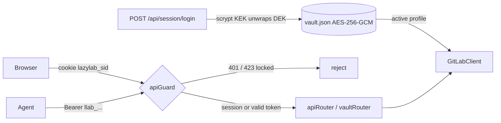

# lazylab dev tracker (pending)

Open epics and tasks for lazylab, plus the baseline audit of what is wired to GitLab and what is a stub, taken 2026-10-17 after import from Google AI Studio.

Status keys: `[ ]` open, `[~]` in progress, `[x]` done. Task IDs are `<epic>-<n>` and stay stable once assigned.

## Audit baseline (2026-10-17)

Classification of the live (token configured) code path. With no token everything runs on in-memory demo data in `server/gitlabClient.ts`, and mutations are lost on restart.

- **WIRED**: calls the correct GitLab REST v4 endpoint, and the result reaches the UI correctly.
- **PARTIAL**: calls GitLab but has a defect, an invalid endpoint, or a fabricated fallback.
- **STUB**: no real implementation in live mode.
- **DEMO**: exists only for the demo/visual layer.

### Server: GitLab features

| Area | Feature | Status | Notes |
|---|---|---|---|
| Auth | verify / save / clear token | WIRED | Since 2026-10-17 (second pass), save/clear create/deactivate an encrypted vault profile |
| Sync | auto-fetch timer + SSE `/api/events` | PARTIAL | Calls global endpoints that do not exist (see GL-1). Refreshes only the `:all` cache keys, so project-scoped keys go stale |
| Projects | list | WIRED | Capped at 50, no pagination |
| Projects | update settings | WIRED | |
| Projects | avatar upload | STUB | In live mode it mutates the demo array; GitLab is never called |
| Milestones | list | PARTIAL | Project scope OK. `/groups/all/milestones` is not a GitLab endpoint. Stats fall back to fake 2/5/60% |
| Milestones | create | WIRED | |
| Work items | list | WIRED | Capped at 50 |
| Work items | create / update | PARTIAL | Returns the raw GitLab object, not mapped to `GitLabWorkItem` (no `work_item_type`, `subtasks`). Update drops an empty `title`/`description` because of a truthy check |
| Work items | subtasks (checkbox lines) | PARTIAL | IDs are positional; toggle returns `[]`; demo-mode addSubTask on a missing item falls through to a live fetch and throws |
| Notes | list / create (issues and MRs) | WIRED | |
| Notes | attachments | STUB | The file is inlined as a base64 data URL in the note body and never uploaded via `/projects/:id/uploads`. `express.json()` 100 kb limit rejects most files |
| MRs | list | PARTIAL | `approved` is derived from `approved_by`, which the list endpoint does not return, so it is always false live |
| MRs | approve / unapprove / merge | WIRED | |
| MRs | update | PARTIAL | `draft` is ignored live |
| MRs | create | WIRED | Agent API only; no UI |
| Pipelines | list | PARTIAL | Project scope OK. A global `/pipelines` endpoint does not exist |
| Pipelines | jobs, retry, cancel, play job | WIRED | |
| Jobs | trace | WIRED | Whole log per request, no incremental tail; errors are masked as a fake trace |
| Runners | list | WIRED | `/runners` returns only runners the user owns, not the admin `/runners/all` |
| Runners | pause, assign, unassign, delete, runner jobs | WIRED | |
| Runners | register | WIRED | Fixed in the second pass (GL-6): uses the returned token, saves it to the vault, surfaces API errors |
| Labels | list | PARTIAL | Project scope OK. Global `/labels` does not exist |
| Labels | create | WIRED | |
| Packages | list | PARTIAL | Project scope OK. Global `/packages` does not exist |
| Packages | details | WIRED | Server and client function exist, but no UI calls them |
| Tags / releases | list / create | WIRED | Not yet exercised against a live instance |
| CI editor | read `.gitlab-ci.yml` | PARTIAL | `ref=main` is hardcoded (ignores `default_branch`). On any error it returns the **demo YAML**, which a save would then commit to the real repo |
| CI editor | save | WIRED | Returned `commit_id` is random |
| CI editor | lint | STUB | Local naive line parser; does not call GitLab `/projects/:id/ci/lint` |
| Variables | list / save / delete | PARTIAL | Group scope defaults to demo id 101. Save does POST, then PUT on *any* error. Masked values are returned to the browser |
| Badges | list / create / delete | PARTIAL | `/api/badges` defaults to demo id 901 |
| Badges | pipeline-setup preset | PARTIAL | Image URLs hardcode `gitlab.com` (breaks self-hosted). Release badge hardcodes `v2.4.0` via shields.io |
| Pages | info | PARTIAL | Falls back to demo data on error; fabricated defaults (`size_bytes`, `deployed_at`) |
| Pages | update | WIRED | |

### Server: infrastructure

| Component | Status | Notes |
|---|---|---|
| `cacheDb` | PARTIAL | `expiresAt` is stored but never checked, so entries never expire. The "WAL" is an append-only JSON-lines file, not SQLite WAL. The whole sql.js DB is exported to disk on each write batch. Journal file and `wal_logs` table grow without bound |
| `metricsManager` | PARTIAL | Real counters and rate-limit header parsing, but seeded with fake totals (142/488) and random 30-minute history |
| `/api/metrics/simulate-hit` | DEMO | Dashboard "Simulate" buttons |
| Error handling | PARTIAL | Most list calls swallow errors and return `[]`, so the UI cannot tell an empty result from a failure |
| Agent API `/api/agent/*` | WIRED | Bearer token auth since the second pass. Defaults to the first project when `projectId` is omitted. `GET /:iid` searches only the first 50 list items. Skill text is duplicated in `apiRouter.ts`, `AgentSkillModal.tsx` and `skills/` |

### Frontend

| Area | Status | Notes |
|---|---|---|
| All views call `src/services/api.ts` → `/api/*` | WIRED | No direct GitLab calls from the browser |
| Sync progress bar | DEMO | Progress percentage and stage text are timer-driven, not tied to real sync steps |
| Global search (Ctrl+K) | WIRED | Client-side filter over already-loaded data |
| External assets | — | Google Fonts, Unsplash avatars in demo data, and shields.io all need network access |
| Bundle | — | Single 549 kB JS chunk |

## Done this session (2026-10-17)

- [x] Removed Gemini / AI Studio: `@google/genai` dependency, `metadata.json`, AI Studio README, `APP_URL` env, `DISABLE_HMR` config
- [x] Removed unused deps: `motion`, `ws`, `@types/ws`, `dotenv` (Bun loads `.env`), `tsx`, `esbuild`, `autoprefixer`; build-only deps moved to `devDependencies`
- [x] Bun on metal: `bun run dev` (watch) and `bun run start` (production)
- [x] Docker: multi-stage `Dockerfile` (oven/bun, non-root, `/data` volume), `compose.yaml` publishing on `127.0.0.1` only, `.dockerignore`
- [x] Bind `HOST` defaults to `127.0.0.1`; `LAZYLAB_DATA_DIR` env for the cache location
- [x] Vite is imported only in dev, so the production image runs without it
- [x] Fixed dev double-mount: `vite.config.ts` also mounted `apiRouter`, which created two cacheDb instances and two auto-fetch timers writing the same files
- [x] `skills/.claude`, `skills/.codex`, `skills/.antigravity` with the `lazylab-agent` skill; removed `SKILL_LAZYLAB_AGENT.md`
- [x] Verified: `tsc --noEmit` clean, `vite build` OK, `bun run start`/`dev` serve the SPA and API, `docker build` + `docker run` serve the SPA and API

## Done 2026-10-17 (second pass): authentication + vault

Scope change: lazylab runs on the desktop and is used from a laptop, so it needs login, an encrypted secrets store and HTTPS. Decisions:
- **Vault unlock:** login password only (no keyfile auto-unlock).
- **Transport:** built-in TLS plus proxy support.
- **Vault contents:** GitLab profiles, CI secrets, runner tokens, generic secrets.

- [x] AUTH-1 First-run setup with a setup code printed to the server log; single admin account
- [x] AUTH-2 Vault `server/vault.ts`: scrypt(N=2^16) KEK → wrapped random DEK → AES-256-GCM payload. Atomic `0600` writes. Locked after restart
- [x] AUTH-3 In-memory sessions, HttpOnly + SameSite=Strict (+Secure over HTTPS), 12 h idle / 7 d absolute
- [x] AUTH-4 Origin check on mutating requests (was SEC-2), `LAZYLAB_PUBLIC_HOSTS` for Host-rewriting proxies
- [x] AUTH-5 Login and setup throttling per IP (5 free attempts, then exponential up to 15 min)
- [x] AUTH-6 Lock vault (wipes key, signs out every device, stops sync); change password (re-wraps DEK); signed-in devices list
- [x] AUTH-7 GitLab profiles in the vault; multiple hosts; activate/deactivate; `GITLAB_TOKEN` imported once at setup (was SEC-3)
- [x] AUTH-8 CI secrets with push to project/group variables, push targets recorded
- [x] AUTH-9 Runner tokens saved automatically on registration (with GL-6 fix)
- [x] AUTH-10 Agent bearer tokens (`llab_…`, SHA-256 stored); `/api/agent/*` returns 401 or 423; skills updated for `LAZYLAB_URL` / `LAZYLAB_TOKEN`
- [x] AUTH-11 Built-in HTTPS (`LAZYLAB_TLS`), self-signed cert with SANs + logged fingerprint, or your own cert; `LAZYLAB_TRUST_PROXY`
- [x] AUTH-12 Security headers (nosniff, frame DENY, no-referrer); plain-HTTP-on-LAN startup warning (was SEC-5)
- [x] AUTH-13 UI: setup/login screen, Vault view (profiles, CI secrets, runner tokens, secrets, agent tokens, account), sign-out
- [x] Verified:
  - curl flow (setup, login, throttle, origin rejection, reveal, agent token, restart → locked/423, password change, lock)
  - Container with TLS
  - Headless Chromium UI flow (setup → vault → add/reveal secret → agent token → sign out → sign in), no page errors

## Epic SEC: hardening follow-ups

- [ ] SEC-1 Unit tests for vault crypto (wrong password, tamper detection, password change) and `apiGuard` (bun test)
- [ ] SEC-2 Step-up re-authentication (password prompt) before reveal, agent token creation and profile changes
- [ ] SEC-3 Revoke a single device session (today only lock-all)
- [ ] SEC-4 Variables view: stop returning masked/protected values to the browser; "save to vault" action that creates a CI secret
- [ ] SEC-5 Vault backup/export (still encrypted) and a printable recovery key; today a forgotten password means data loss
- [ ] SEC-6 Agent token scopes (read-only / write), expiry, last-used timestamp
- [ ] SEC-7 Audit trail for vault reads and pushes in the journal
- [ ] SEC-8 Cache at rest: encrypt `labwi_cache.sqlite` with the DEK, or purge it on lock
- [ ] SEC-9 Content-Security-Policy header (prod only; Vite dev injects inline scripts)
- [ ] SEC-10 Prune the login-failure map (grows by IP without bound)
- [ ] SEC-11 Optional TOTP second factor
- [ ] SEC-12 Host header allowlist (DNS rebinding). Lower priority now that the API requires a session
- [ ] SEC-13 Verify behind Tailscale Serve: Host / X-Forwarded-Proto handling and the `Secure` cookie flag
- [ ] SEC-14 Verify CI secret push and profile add against a live GitLab instance (only demo mode has been exercised)

## Epic GL: GitLab client correctness

- [ ] GL-1 Remove the non-existent global endpoints (`/groups/all/milestones`, `/pipelines`, `/labels`, `/packages`). Aggregate per-project over the membership list, or require a project
- [ ] GL-2 Pagination via `Link` / `x-next-page` headers for projects, issues, MRs, pipelines
- [ ] GL-3 Map create/update responses through the same normaliser as the list calls (work items, MRs)
- [ ] GL-4 Send `draft` on MR update; fetch `/approvals` for the approval state
- [ ] GL-5 Allow clearing `title`/`description` (use `!== undefined`, not truthiness)
- [x] GL-6 Runner register: use the returned token in `registerCommand`; surface API errors instead of returning a fake runner
- [ ] GL-7 CI config: read from the project's `default_branch`. Never fall back to demo YAML in live mode; return a "no file" state instead
- [ ] GL-8 CI lint: call `POST /projects/:id/ci/lint`; keep the local parser only for the graph preview
- [ ] GL-9 Variables: remove the demo default group id; upsert by checking existence (404) instead of PUT on any error
- [ ] GL-10 Badges: remove the demo default id 901; build image URLs from the configured host; drop the hardcoded release version
- [ ] GL-11 Project avatar: implement the multipart `PUT /projects/:id` upload, or remove the feature
- [ ] GL-12 Note attachments: upload via `POST /projects/:id/uploads` and insert the returned markdown
- [ ] GL-13 Pages: remove fabricated defaults and the demo fallback
- [ ] GL-14 Milestone stats: compute from issues, or show "n/a"; no fake numbers
- [ ] GL-15 Return errors from list calls (typed error payload) instead of `[]`; show them in the UI
- [ ] GL-16 Agent API: `GET /:iid` fetches the single item directly; require `projectId` or a configured default project

## Epic CACHE: local storage layer

- [ ] CACHE-1 Replace sql.js with `bun:sqlite` (both targets now run Bun): real WAL mode, no full-DB export per write
- [ ] CACHE-2 Enforce TTL in `get()`; stale-while-revalidate for the UI
- [ ] CACHE-3 Bound the journal: rotate or truncate the `.wal` file and prune `wal_logs` (keep N rows / N days)
- [ ] CACHE-4 Auto-fetch refreshes the project-scoped keys the UI actually uses
- [ ] CACHE-5 Serve the last cached data when GitLab is unreachable, flagged as stale (offline mode)
- [ ] CACHE-6 Rename `labwi_*` leftovers (cache files, `labwi_theme` localStorage key)

## Epic UI: honest UI

- [ ] UI-1 Remove fake metric seeds and random history in `metricsManager`; start from zero
- [ ] UI-2 Remove the "Simulate API/Cache hit" buttons and `/api/metrics/simulate-hit`, or move them behind demo mode
- [ ] UI-3 Drive the sync progress bar from real SSE progress events
- [ ] UI-4 Visible demo-mode banner on every view
- [ ] UI-5 Package details view uses `getPackageDetails` (or remove the unused API)
- [ ] UI-6 Create-MR form in the UI (server support exists)

## Epic LOCAL: local-first / offline assets

- [ ] LOCAL-1 Self-host fonts (`@fontsource/jetbrains-mono`, `@fontsource/plus-jakarta-sans`); remove the Google Fonts links
- [ ] LOCAL-2 Demo data: local placeholder avatars instead of Unsplash
- [ ] LOCAL-3 Badges preview without shields.io, or mark it as needing network access

## Epic BUILD: build, quality, release

- [x] BUILD-1 `git init`, `main` + `develop` branches, first commit of the imported baseline
- [ ] BUILD-2 Vite `manualChunks`: split `react`/`react-dom`, `lucide-react`, and the heavy views (pipeline editor, dashboard)
- [ ] BUILD-3 `bun test` setup: unit tests for `yamlParser`, `cacheDb`, response normalisers; route tests against the demo client
- [ ] BUILD-4 CI pipeline: lint, test, build, docker build
- [ ] BUILD-5 Container `HEALTHCHECK` on `/api/status` (needs a lightweight health route that does not call GitLab)
- [ ] BUILD-6 Split `gitlabClient.ts` (3.4k lines): demo dataset into `server/demo/`, one module per GitLab resource
- [ ] BUILD-7 Single source for the agent skill text: serve `/api/agent/skill.md` from `skills/.claude/lazylab-agent/SKILL.md` and have `AgentSkillModal` fetch it

## Epic DEMO: demo mode decision

- [ ] DEMO-1 Decide whether demo mode stays (onboarding / offline UI dev) or goes. If it stays, isolate it behind a `DemoGitLabClient` that implements the same interface, so live code paths stop branching on `isDemoMode`
