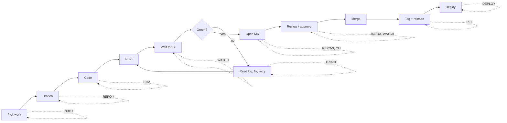
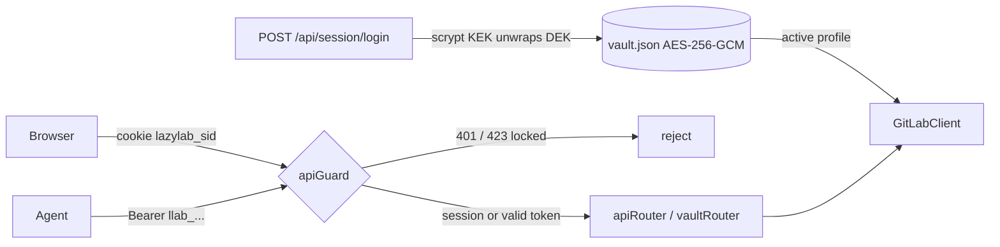
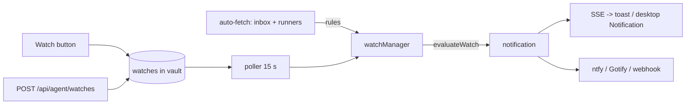
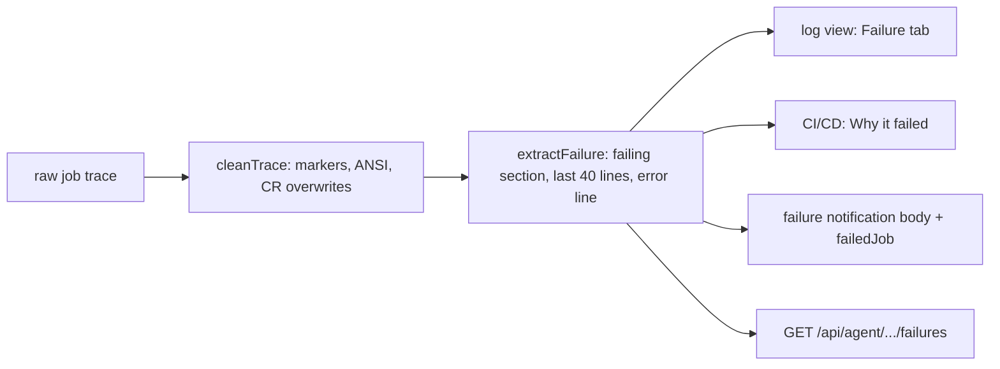

# lazylab dev tracker (pending)

Open epics and tasks for lazylab, plus the baseline audit of what is wired to GitLab and what is a stub, taken 2026-10-17 after import from Google AI Studio.

Status keys: `[ ]` open, `[~]` in progress, `[x]` done. Task IDs are `<epic>-<n>` and stay stable once assigned.

## Product audit: developer QoL (2026-10-17)

### Verdict

As imported, lazylab is mostly a second UI for things GitLab's own UI already does, and on its own that is not a reason for a developer to switch. lazylab becomes worth running when it does what a hosted UI cannot, because it runs on the developer's own machine:

1. **It sits next to the work.** The same host has the git checkouts, Docker, the runners and the editor. GitLab cannot see any of these.
2. **It holds secrets and brokers access.** Agents, scripts and the laptop get scoped lazylab tokens instead of a GitLab PAT with `api` scope.
3. **It aggregates and remembers.** It can show one view across every project and every GitLab host, kept in a local cache with "since you last looked" state.
4. **It can act on your behalf.** It can watch pipelines, retry infrastructure failures, notify the laptop or phone, and prepare releases.

Test for every new feature: does it remove a context switch or a repeated manual step, and does it need to run locally? If neither, it belongs in GitLab's UI rather than here.

### Where the developer loop loses time

| Step | Today without lazylab | lazylab answer |
|---|---|---|
| Pick work | Check To-Do list, MR lists and issue boards per project | INBOX: one list across projects and hosts |
| Branch | Copy the issue number by hand, type a branch name | REPO-4: start work on an issue |
| Code | Copy CI variables into `.env` by hand; secrets drift | ENV-1/2: pull or inject secrets from the vault |
| Wait for CI | Refresh the pipeline page, or forget about it | WATCH: notification on the laptop or phone when it finishes |
| Fix failures | Scroll a 5 MB log; retry flaky jobs by hand | TRIAGE: failure excerpt, flaky detection, retry policy |
| Open MR | Web form, copy the branch name | REPO-3 / CLI-1: MR from the current branch |
| Review | Email notifications, tab hunting | INBOX + WATCH: review queue, re-review on new push |
| Release | Work out the semver bump and write the changelog by hand | REL: bump and changelog from Conventional Commits |
| Deploy | Environments page per project | DEPLOY: environments across projects, review app cleanup |
| Across N projects | Repeat every setting change N times | FLEET: bulk labels, settings baseline, project bootstrap |
| Agents | Hand the agent a full-scope PAT | AGENT: MCP server, scoped tokens, approval queue |

### Integrations considered

| Integration | Verdict | Where |
|---|---|---|
| Notification push (ntfy, Gotify, generic webhook, browser Notification API) | Yes: covers phone, laptop and chat (Slack/Discord/Matrix incoming webhooks) with one mechanism | WATCH-2/3 |
| GitLab webhooks | Yes, optional: replaces polling when GitLab can reach the desktop (Tailscale Funnel, LAN self-hosted GitLab) | WATCH-5 |
| MCP (Model Context Protocol) | Yes: Claude Code and Codex connect natively instead of using the curl skill | AGENT-1 |
| Local git checkouts | Yes: branch, ahead/behind and pipeline status for local HEAD | REPO |
| Editor deep links (`vscode://`, `cursor://`, JetBrains) | Yes: little effort, removes "find that file" steps | REPO-5 |
| Docker on the host | Opt-in only (socket access is root-equivalent): local runner lifecycle | RL-2 |
| Container registry | Yes: storage cleanup is a recurring chore | REG |
| Renovate / Dependabot MRs | Yes: group and bulk-merge across projects | FLEET-4 |
| Jira / Linear | No for now: GitLab work items cover it; revisit if asked | n/a |
| Hosted LLM in the app | No: the mission is local-first. Agents are reached through MCP and skills instead | AGENT |
| Sentry / uptime | Later: link releases to errors once REL and DEPLOY exist | n/a |

### Non-goals

- Full diff and code review UI: GitLab's review UI is the right tool there. lazylab links to it and adds queue, state and notifications around it.
- Wiki, snippets, epics, boards editing.
- Being a multi-user server: lazylab has one owner and many devices.

### Roadmap

1. **Foundation, blocks everything else:** GL-1, GL-14, GL-15, GL-2, CACHE-1/2/4, BUILD-3. Cross-project views are wrong while list calls hit non-existent endpoints and swallow errors.
2. **First differentiators, most QoL for the effort:** ~~INBOX-1/2~~, ~~WATCH-1..4~~, ~~TRIAGE-1/6~~, ENV-4, AGENT-1.
3. **Away from the browser:** CLI-1/2/4, ENV-1/2, REPO-1..4.
4. **Chores at scale:** REL, FLEET, DEPLOY, REG, RL.

## Audit baseline (2026-10-17)

Classification of the live (token configured) code path. With no token everything runs on in-memory demo data in `server/gitlabClient.ts`, and mutations are lost on restart.

- **WIRED**: calls the correct GitLab REST v4 endpoint, and the result reaches the UI correctly.
- **PARTIAL**: calls GitLab but has a defect, an invalid endpoint, or a fabricated fallback.
- **STUB**: no real implementation in live mode.
- **DEMO**: exists only for the demo/visual layer.

### Server: GitLab features

| Area | Feature | Status | Notes |
|---|---|---|---|
| Auth | verify / save / clear token | WIRED | Since 2026-10-17 (second pass), save/clear create/deactivate an encrypted vault profile |
| Sync | auto-fetch timer + SSE `/api/events` | WIRED | Since 2026-10-17 (third pass): fans out over the 15 most recently active member projects and refreshes the per-project cache keys; also refreshes the inbox |
| Projects | list | WIRED | Capped at 50, no pagination |
| Projects | update settings | WIRED | |
| Projects | avatar upload | STUB | In live mode it mutates the demo array; GitLab is never called |
| Milestones | list | WIRED | Third pass: per-project fan-out; active milestones only; counts from `issues_statistics`, "n/a" when unavailable |
| Milestones | create | WIRED | |
| Work items | list | WIRED | Capped at 50 per project. All-projects view fans out over member projects (was `/issues?scope=all`, which includes every public project on gitlab.com) |
| Work items | create / update | PARTIAL | Returns the raw GitLab object, not mapped to `GitLabWorkItem` (no `work_item_type`, `subtasks`). Update drops an empty `title`/`description` because of a truthy check |
| Work items | subtasks (checkbox lines) | PARTIAL | IDs are positional; toggle returns `[]`; demo-mode addSubTask on a missing item falls through to a live fetch and throws |
| Notes | list / create (issues and MRs) | WIRED | |
| Notes | attachments | STUB | The file is inlined as a base64 data URL in the note body and never uploaded via `/projects/:id/uploads`. `express.json()` 100 kb limit rejects most files |
| MRs | list | PARTIAL | `approved` is derived from `approved_by`, which the list endpoint does not return, so it is always false live. List responses carry no pipeline; only the inbox fetches single MRs for `head_pipeline`. All-projects view fans out like work items |
| MRs | approve / unapprove / merge | WIRED | |
| MRs | update | PARTIAL | `draft` is ignored live |
| MRs | create | WIRED | Agent API only; no UI |
| Pipelines | list | WIRED | Third pass: per-project fan-out, newest 50 |
| Pipelines | jobs, retry, cancel, play job, run with variables | WIRED | Fifth pass: `POST /projects/:id/pipeline`; job retry uses `/jobs/:id/retry` (the log view used `play`, which only works on manual jobs) |
| Jobs | trace, failure excerpt | WIRED | Whole log per request (tail capped at 2 MB), no incremental tail; errors are masked as a fake trace. Failed jobs return a failure excerpt with the trace |
| Runners | list | WIRED | `/runners` returns only runners the user owns, not the admin `/runners/all` |
| Runners | pause, assign, unassign, delete, runner jobs | WIRED | |
| Runners | register | WIRED | Fixed in the second pass (GL-6): uses the returned token, saves it to the vault, surfaces API errors |
| Labels | list | WIRED | Third pass: per-project fan-out, de-duplicated by name; project scope uses `with_counts=true` |
| Labels | create | WIRED | |
| Packages | list | WIRED | Third pass: per-project fan-out |
| Packages | details | WIRED | Server and client function exist, but no UI calls them |
| Tags / releases | list / create | WIRED | Not yet exercised against a live instance |
| CI editor | read `.gitlab-ci.yml` | PARTIAL | `ref=main` is hardcoded (ignores `default_branch`). On any error it returns the **demo YAML**, which a save would then commit to the real repo |
| CI editor | save | WIRED | Returned `commit_id` is random |
| CI editor | lint | STUB | Local naive line parser; does not call GitLab `/projects/:id/ci/lint` |
| Variables | list / save / delete | PARTIAL | Group scope defaults to demo id 101. Save does POST, then PUT on *any* error. Masked values are returned to the browser |
| Badges | list / create / delete | PARTIAL | `/api/badges` defaults to demo id 901 |
| Badges | pipeline-setup preset | PARTIAL | Image URLs hardcode `gitlab.com` (breaks self-hosted). Release badge hardcodes `v2.4.0` via shields.io |
| Pages | info | PARTIAL | Falls back to demo data on error; fabricated defaults (`size_bytes`, `deployed_at`) |
| Pages | update | WIRED | |

### Server: infrastructure

| Component | Status | Notes |
|---|---|---|
| `cacheDb` | PARTIAL | TTL enforced since the third pass (`get(key, { allowStale })` keeps expired rows for offline use). The "WAL" is an append-only JSON-lines file, not SQLite WAL. The whole sql.js DB is exported to disk on each write batch. Journal file and `wal_logs` table grow without bound |
| `metricsManager` | PARTIAL | Real counters and rate-limit header parsing, but seeded with fake totals (142/488) and random 30-minute history |
| `/api/metrics/simulate-hit` | DEMO | Dashboard "Simulate" buttons |
| Error handling | PARTIAL | Most list calls swallow errors and return `[]`, so the UI cannot tell an empty result from a failure |
| Agent API `/api/agent/*` | WIRED | Bearer token auth since the second pass. Defaults to the first project when `projectId` is omitted. `GET /:iid` searches only the first 50 list items. Skill text is duplicated in `apiRouter.ts`, `AgentSkillModal.tsx` and `skills/` |

### Frontend

| Area | Status | Notes |
|---|---|---|
| All views call `src/services/api.ts` → `/api/*` | WIRED | No direct GitLab calls from the browser |
| Sync progress bar | DEMO | Progress percentage and stage text are timer-driven, not tied to real sync steps |
| Global search (Ctrl+K) | WIRED | Client-side filter over already-loaded data |
| External assets | — | Google Fonts, Unsplash avatars in demo data, and shields.io all need network access |
| Bundle | — | Single 549 kB JS chunk |

## Done this session (2026-10-17)

- [x] Removed Gemini / AI Studio: `@google/genai` dependency, `metadata.json`, AI Studio README, `APP_URL` env, `DISABLE_HMR` config
- [x] Removed unused deps: `motion`, `ws`, `@types/ws`, `dotenv` (Bun loads `.env`), `tsx`, `esbuild`, `autoprefixer`; build-only deps moved to `devDependencies`
- [x] Bun on metal: `bun run dev` (watch) and `bun run start` (production)
- [x] Docker: multi-stage `Dockerfile` (oven/bun, non-root, `/data` volume), `compose.yaml` publishing on `127.0.0.1` only, `.dockerignore`
- [x] Bind `HOST` defaults to `127.0.0.1`; `LAZYLAB_DATA_DIR` env for the cache location
- [x] Vite is imported only in dev, so the production image runs without it
- [x] Fixed dev double-mount: `vite.config.ts` also mounted `apiRouter`, which created two cacheDb instances and two auto-fetch timers writing the same files
- [x] `skills/.claude`, `skills/.codex`, `skills/.antigravity` with the `lazylab-agent` skill; removed `SKILL_LAZYLAB_AGENT.md`
- [x] Verified: `tsc --noEmit` clean, `vite build` OK, `bun run start`/`dev` serve the SPA and API, `docker build` + `docker run` serve the SPA and API

## Done 2026-10-17 (second pass): authentication + vault

Scope change: lazylab runs on the desktop and is used from a laptop, so it needs login, an encrypted secrets store and HTTPS. Decisions:
- **Vault unlock:** login password only (no keyfile auto-unlock).
- **Transport:** built-in TLS plus proxy support.
- **Vault contents:** GitLab profiles, CI secrets, runner tokens, generic secrets.

- [x] AUTH-1 First-run setup with a setup code printed to the server log; single admin account
- [x] AUTH-2 Vault `server/vault.ts`: scrypt(N=2^16) KEK → wrapped random DEK → AES-256-GCM payload. Atomic `0600` writes. Locked after restart
- [x] AUTH-3 In-memory sessions, HttpOnly + SameSite=Strict (+Secure over HTTPS), 12 h idle / 7 d absolute
- [x] AUTH-4 Origin check on mutating requests (was SEC-2), `LAZYLAB_PUBLIC_HOSTS` for Host-rewriting proxies
- [x] AUTH-5 Login and setup throttling per IP (5 free attempts, then exponential up to 15 min)
- [x] AUTH-6 Lock vault (wipes key, signs out every device, stops sync); change password (re-wraps DEK); signed-in devices list
- [x] AUTH-7 GitLab profiles in the vault; multiple hosts; activate/deactivate; `GITLAB_TOKEN` imported once at setup (was SEC-3)
- [x] AUTH-8 CI secrets with push to project/group variables, push targets recorded
- [x] AUTH-9 Runner tokens saved automatically on registration (with GL-6 fix)
- [x] AUTH-10 Agent bearer tokens (`llab_…`, SHA-256 stored); `/api/agent/*` returns 401 or 423; skills updated for `LAZYLAB_URL` / `LAZYLAB_TOKEN`
- [x] AUTH-11 Built-in HTTPS (`LAZYLAB_TLS`), self-signed cert with SANs + logged fingerprint, or your own cert; `LAZYLAB_TRUST_PROXY`
- [x] AUTH-12 Security headers (nosniff, frame DENY, no-referrer); plain-HTTP-on-LAN startup warning (was SEC-5)
- [x] AUTH-13 UI: setup/login screen, Vault view (profiles, CI secrets, runner tokens, secrets, agent tokens, account), sign-out
- [x] Verified:
  - curl flow (setup, login, throttle, origin rejection, reveal, agent token, restart → locked/423, password change, lock)
  - Container with TLS
  - Headless Chromium UI flow (setup → vault → add/reveal secret → agent token → sign out → sign in), no page errors

## Done 2026-10-17 (third pass): foundation + inbox

- [x] GL-1 Removed the non-existent global endpoints. `forRecentProjects` fans out over the 15 most recently active member projects (4 in flight) for milestones, pipelines, labels, packages, work items and MRs
- [x] GL-14 Milestone counts from `issues_statistics`; the UI shows "n/a" instead of the fake 60%
- [x] CACHE-2 TTL enforced in `cacheDb.get`; `allowStale` for later offline use (CACHE-5)
- [x] CACHE-4 Auto-fetch now refreshes the per-project keys the views read
- [x] INBOX-1 `GET /api/inbox` and `GET /api/agent/inbox` (`server/inbox.ts`): review requests, own MRs with `head_pipeline`, assigned issues, To-Dos merged onto items; partial failures reported in `errors[]`
- [x] INBOX-2 Inbox is the default tab, grouped into action / waiting / assigned, with an action count badge in the nav
- [~] BUILD-3 `bun test` set up (`tests/`, `bunfig.toml` preload isolates `LAZYLAB_DATA_DIR`): `mapLimit`, cache TTL, inbox classification and assembly, demo inbox. Still to cover: `yamlParser`, normalisers, routes
- Verified: `tsc`, `vite build`, 19 tests, headless Chromium flow (setup → inbox → milestones → dashboard → vault → agent token → sign out → sign in), no page errors

Follow-ups found on the way:
- [ ] INBOX-7 "Already approved by me" state for review requests (needs `/merge_requests/:iid/approvals` per item)
- [ ] GL-17 Make `AGGREGATE_PROJECT_LIMIT` (15) a setting, or let the user pin the projects the all-projects views aggregate
- [ ] GL-18 MR list pipeline status for the MR view (single-MR fetch or `/pipelines?ref=`) — list responses have none

## Done 2026-10-17 (fourth pass): watches and notifications

- [x] WATCH-1 Watches on pipelines, jobs and MRs (`server/watch.ts`): 15 s poller; pipelines/jobs end on a terminal state (incl. `manual`), MRs on merged/closed and notify on conflicts and finished head pipelines. Stored in the vault per GitLab profile; 404 removes the watch
- [x] WATCH-2 SSE `notification` / `watches_changed`; toast in the foreground, desktop `Notification` when the tab is hidden; bell menu with history and active watches
- [x] WATCH-3 Push channels in the vault: ntfy (JSON publish, bearer token), Gotify (`X-Gotify-Key`), webhook (`json` / `slack` / `discord`); all or failures only; test send; delivery health
- [x] WATCH-4 Rules: auto-watch running pipelines of my MRs, new review requests, new commits on MRs I review, runner offline / back online. First refresh after unlock is a silent baseline
- Agent API: `GET/POST /api/agent/watches`
- Verified: 34 tests (wire formats, evaluation, manager with a real vault), curl end-to-end against a capture server (formats, failures-only filter, masking, agent bearer, restart persistence), headless Chromium (watch toggle, bell menu, add channel), no page errors

Follow-ups:
- [ ] WATCH-7 Snooze / mute a watch or rule for N hours; quiet hours for push channels
- [ ] WATCH-8 Notification history survives restart (today in memory, cleared on lock)
- [ ] WATCH-9 MR watch: notify on new approvals and new comments (needs notes polling)
- [ ] WATCH-10 Poll interval setting; back off on GitLab rate-limit headers

## Done 2026-10-17 (fifth pass): CI failure triage and run pipeline

- [x] TRIAGE-1 `server/triage.ts`: parses `section_start`/`section_end`, skips post-script runner sections, keeps the last 40 lines of the failing section, highlights error lines, picks an `errorLine` (cause lines such as `error:`/`fatal` before summary lines such as `1 fail`), exit code, `failure_reason` hint and `retryable`
  - Log view opens on a Failure tab for failed jobs (copy excerpt, GitLab link); the trace response carries the excerpt so the log is fetched once
  - CI/CD: failed pipelines list each failed job's error line (allowed failures excluded)
  - Watch failure notifications append `job: error line` and carry `failedJob`; "Why it failed" in the bell and a click on the desktop notification open the excerpt
- [x] TRIAGE-6 Run pipeline: ref with branch suggestions, variables prefilled from GraphQL `ciConfigVariables` (descriptions, option lists), last run per project in localStorage, watch by default. Variables left at the declared default are not sent
- Fixed: the log view's Retry called `play` (manual jobs only); finished jobs now use `/jobs/:id/retry` and the new job is watched and opened
- Agent API: `POST /api/agent/pipelines`, `GET /api/agent/pipelines/:id/failures`, `GET /api/agent/jobs/:id/failure`
- Verified: 49 tests (trace parsing on runner-shaped traces, nested sections, CR progress, window cap, input validation, enriched notification through the manager), curl end-to-end in demo mode (excerpt, failures, branches, declared variables, run, validation errors, cross-origin rejection, retry, ntfy body with the error line, agent bearer), headless Chromium (Why it failed, Failure tab, run form with an option variable), no page errors
- Not verified against live GitLab: `ciConfigVariables` (GraphQL field availability varies by version), `/jobs/:id/retry` response, trace section markers from a real runner

Follow-ups:
- [ ] TRIAGE-8 Run pipeline from the Inbox and from an MR row (prefill the source branch)
- [ ] TRIAGE-9 Excerpt for very large logs without downloading the whole trace (needs TRIAGE-5 offset fetch)
- [ ] TRIAGE-10 Show failures for jobs in child/downstream pipelines (bridges)

## Epic SEC: hardening follow-ups

- [ ] SEC-1 Unit tests for vault crypto (wrong password, tamper detection, password change) and `apiGuard` (bun test)
- [ ] SEC-2 Step-up re-authentication (password prompt) before reveal, agent token creation and profile changes
- [ ] SEC-3 Revoke a single device session (today only lock-all)
- [ ] SEC-4 Variables view: stop returning masked/protected values to the browser; "save to vault" action that creates a CI secret
- [ ] SEC-5 Vault backup/export (still encrypted) and a printable recovery key; today a forgotten password means data loss
- [ ] SEC-6 Agent token scopes (read-only / write), expiry, last-used timestamp
- [ ] SEC-7 Audit trail for vault reads and pushes in the journal
- [ ] SEC-8 Cache at rest: encrypt `labwi_cache.sqlite` with the DEK, or purge it on lock
- [ ] SEC-9 Content-Security-Policy header (prod only; Vite dev injects inline scripts)
- [ ] SEC-10 Prune the login-failure map (grows by IP without bound)
- [ ] SEC-11 Optional TOTP second factor
- [ ] SEC-12 Host header allowlist (DNS rebinding). Lower priority now that the API requires a session
- [ ] SEC-13 Verify behind Tailscale Serve: Host / X-Forwarded-Proto handling and the `Secure` cookie flag
- [ ] SEC-14 Verify CI secret push and profile add against a live GitLab instance (only demo mode has been exercised)

## Epic GL: GitLab client correctness

- [x] GL-1 Remove the non-existent global endpoints (`/groups/all/milestones`, `/pipelines`, `/labels`, `/packages`). Aggregate per-project over the membership list, or require a project
- [ ] GL-2 Pagination via `Link` / `x-next-page` headers for projects, issues, MRs, pipelines
- [ ] GL-3 Map create/update responses through the same normaliser as the list calls (work items, MRs)
- [ ] GL-4 Send `draft` on MR update; fetch `/approvals` for the approval state
- [ ] GL-5 Allow clearing `title`/`description` (use `!== undefined`, not truthiness)
- [x] GL-6 Runner register: use the returned token in `registerCommand`; surface API errors instead of returning a fake runner
- [ ] GL-7 CI config: read from the project's `default_branch`. Never fall back to demo YAML in live mode; return a "no file" state instead
- [ ] GL-8 CI lint: call `POST /projects/:id/ci/lint`; keep the local parser only for the graph preview
- [ ] GL-9 Variables: remove the demo default group id; upsert by checking existence (404) instead of PUT on any error
- [ ] GL-10 Badges: remove the demo default id 901; build image URLs from the configured host; drop the hardcoded release version
- [ ] GL-11 Project avatar: implement the multipart `PUT /projects/:id` upload, or remove the feature
- [ ] GL-12 Note attachments: upload via `POST /projects/:id/uploads` and insert the returned markdown
- [ ] GL-13 Pages: remove fabricated defaults and the demo fallback
- [x] GL-14 Milestone stats: compute from issues, or show "n/a"; no fake numbers
- [ ] GL-15 Return errors from list calls (typed error payload) instead of `[]`; show them in the UI
- [ ] GL-16 Agent API: `GET /:iid` fetches the single item directly; require `projectId` or a configured default project

## Epic CACHE: local storage layer

- [ ] CACHE-1 Replace sql.js with `bun:sqlite` (both targets now run Bun): real WAL mode, no full-DB export per write
- [x] CACHE-2 Enforce TTL in `get()`; stale-while-revalidate for the UI
- [ ] CACHE-3 Bound the journal: rotate or truncate the `.wal` file and prune `wal_logs` (keep N rows / N days)
- [x] CACHE-4 Auto-fetch refreshes the project-scoped keys the UI actually uses
- [ ] CACHE-5 Serve the last cached data when GitLab is unreachable, flagged as stale (offline mode)
- [ ] CACHE-6 Rename `labwi_*` leftovers (cache files, `labwi_theme` localStorage key)

## Epic UI: honest UI

- [ ] UI-1 Remove fake metric seeds and random history in `metricsManager`; start from zero
- [ ] UI-2 Remove the "Simulate API/Cache hit" buttons and `/api/metrics/simulate-hit`, or move them behind demo mode
- [ ] UI-3 Drive the sync progress bar from real SSE progress events
- [ ] UI-4 Visible demo-mode banner on every view
- [ ] UI-5 Package details view uses `getPackageDetails` (or remove the unused API)
- [ ] UI-6 Create-MR form in the UI (server support exists)

## Epic LOCAL: local-first / offline assets

- [ ] LOCAL-1 Self-host fonts (`@fontsource/jetbrains-mono`, `@fontsource/plus-jakarta-sans`); remove the Google Fonts links
- [ ] LOCAL-2 Demo data: local placeholder avatars instead of Unsplash
- [ ] LOCAL-3 Badges preview without shields.io, or mark it as needing network access

## Epic BUILD: build, quality, release

- [x] BUILD-1 `git init`, `main` + `develop` branches, first commit of the imported baseline
- [ ] BUILD-2 Vite `manualChunks`: split `react`/`react-dom`, `lucide-react`, and the heavy views (pipeline editor, dashboard)
- [~] BUILD-3 `bun test` setup: unit tests for `yamlParser`, `cacheDb`, response normalisers; route tests against the demo client
- [ ] BUILD-4 CI pipeline: lint, test, build, docker build
- [ ] BUILD-5 Container `HEALTHCHECK` on `/api/status` (needs a lightweight health route that does not call GitLab)
- [ ] BUILD-6 Split `gitlabClient.ts` (3.4k lines): demo dataset into `server/demo/`, one module per GitLab resource
- [ ] BUILD-7 Single source for the agent skill text: serve `/api/agent/skill.md` from `skills/.claude/lazylab-agent/SKILL.md` and have `AgentSkillModal` fetch it

## Epic INBOX: my work across projects and hosts

- [x] INBOX-1 `GET /api/inbox`: MRs where I am reviewer, my open MRs (pipeline, approvals, conflicts, draft), issues assigned to me, pending To-Dos. Uses the global GitLab endpoints that exist (`/merge_requests?scope=…`, `/issues?scope=assigned_to_me`, `/todos`)
- [x] INBOX-2 Inbox view as the default tab, grouped by "needs my action" / "waiting on others" / "assigned"
- [ ] INBOX-3 Mark a To-Do done; snooze an item locally until a date or until it changes
- [ ] INBOX-4 Aggregate across every vault profile (work GitLab + gitlab.com), not only the active one
- [ ] INBOX-5 "New since you last looked" markers, stored locally per item (`updated_at` vs last-seen)
- [ ] INBOX-6 Standup summary: my events since yesterday (`/users/:id/events`) as copyable markdown

## Epic WATCH: notifications and background watching

- [x] WATCH-1 Watch a pipeline, job or MR; the server polls it until a terminal state and records the outcome
- [x] WATCH-2 Browser notifications over SSE (Notification API needs HTTPS or localhost)
- [x] WATCH-3 Push channels stored in the vault: ntfy, Gotify, generic JSON webhook (covers Slack/Discord/Matrix)
- [x] WATCH-4 Auto-watch rules: pipelines of my MRs, MRs where I am reviewer (new push → re-review), runner offline
- [ ] WATCH-5 GitLab webhook receiver `POST /hooks/gitlab` with a secret token, replacing polling when GitLab can reach the host
- [ ] WATCH-6 PWA manifest + service worker so the laptop and phone can install lazylab and receive Web Push

## Epic TRIAGE: CI failure triage

- [x] TRIAGE-1 Failure excerpt: the failing section of a job trace (collapsed `section_start` markers, last N lines before `ERROR: Job failed`), plus `failure_reason`
- [ ] TRIAGE-2 Flaky detection: pass/fail history per job name on the default branch; "retry flaky" action
- [ ] TRIAGE-3 Auto-retry policy for infrastructure failures (`runner_system_failure`, `stuck_or_timeout_failure`, `scheduler_failure`), with a cap
- [ ] TRIAGE-4 Pipeline duration trend and slowest jobs per project
- [ ] TRIAGE-5 Incremental trace tail with live follow (offset-based fetch instead of the whole log per poll)
- [x] TRIAGE-6 Run pipeline for a ref with a variables form (`POST /projects/:id/pipeline`); missing today
- [ ] TRIAGE-7 "Hand to agent": bundle MR diff + failure excerpt + `.gitlab-ci.yml` as a prompt or an MCP resource

## Epic REPO: local checkouts on the lazylab host

- [ ] REPO-1 Workspace roots setting; scan for git repos and match `remote.origin.url` to GitLab projects. In Docker this needs a read-only bind mount
- [ ] REPO-2 Per project: local branch, ahead/behind, dirty state, pipeline for local `HEAD`
- [ ] REPO-3 Create MR from a branch: title from the last commit, `Closes #<iid>` from a `<iid>-slug` branch name
- [ ] REPO-4 Start work on an issue: create `<iid>-<slug>` branch on GitLab, optional local fetch + checkout
- [ ] REPO-5 Editor deep links (`vscode://file/…`, `cursor://`, JetBrains) for file paths in MR changes and job traces
- [ ] REPO-6 Stale branch cleanup: merged branches on the remote and locally

## Epic CLI: `lazy` companion for the laptop and terminal

- [ ] CLI-1 `lazy` Bun CLI over the lazylab API with an agent token; detects the project from `git remote` in the current directory. Commands: `inbox`, `ci [watch]`, `mr create`, `job log --failed`
- [ ] CLI-2 `lazy push`: `git push`, then watch the pipeline and notify on completion
- [ ] CLI-3 TUI mode (lazygit-style panes) for inbox and pipelines
- [ ] CLI-4 Single binary via `bun build --compile` for Linux, macOS and Windows

## Epic ENV: secrets for local development

- [ ] ENV-1 `lazy env pull`: render a project's CI variables (masked ones from the vault) and named vault secrets into `.env` for a given `environment_scope`
- [ ] ENV-2 `lazy run -- <cmd>`: inject the same set as environment variables without writing a file
- [ ] ENV-3 Secret fan-out and rotation: one vault secret pushed to N projects; updating it re-pushes every recorded target
- [ ] ENV-4 Token expiry tracking: PAT (`GET /personal_access_tokens/self`), project/group/deploy tokens; warn N days ahead via WATCH; rotate the PAT (`POST /personal_access_tokens/self/rotate`) and update the vault profile
- [ ] ENV-5 Drift check: vault CI secrets vs variables present in GitLab (presence and flags, not values)

## Epic AGENT: agents as first-class clients

- [ ] AGENT-1 MCP server (streamable HTTP at `/mcp`, bearer auth) exposing inbox, work items, MRs, pipelines, failure excerpt and run-pipeline as tools
- [ ] AGENT-2 Token scopes: read-only / write, per-project allowlist (supersedes SEC-6)
- [ ] AGENT-3 Approval queue: destructive or outward agent actions (merge, delete, push variable) wait for confirmation in the UI or a push notification
- [ ] AGENT-4 Activity log per agent token
- [ ] AGENT-5 Generate the skill and MCP config snippet for Claude Code / Codex from the Vault → Agent tokens screen

## Epic REL: releases from Conventional Commits

- [ ] REL-1 Next version from commits since the last tag (`feat` → minor, `fix` → patch, `!`/`BREAKING CHANGE` → major), with preview
- [ ] REL-2 Changelog grouped by type, editable before publishing
- [ ] REL-3 One action: tag + release + notes on the chosen ref
- [ ] REL-4 Release checks: pipeline green on the ref, milestone closed, no open MRs targeting the milestone

## Epic FLEET: operations across many projects

- [ ] FLEET-1 Label sets: define once, apply to selected projects
- [ ] FLEET-2 Settings baseline: check projects against a profile (protected default branch, approvals, squash, CI badge) with fix actions
- [ ] FLEET-3 Project bootstrap: create a project with CI template, badges, variables and branch protection in one step
- [ ] FLEET-4 Dependency MRs (Renovate/Dependabot) grouped across projects; bulk approve + merge when the pipeline is green

## Epic DEPLOY: environments

- [ ] DEPLOY-1 Environments across projects: last deployment, ref, status, who
- [ ] DEPLOY-2 Re-deploy (retry the deploy job of a previous deployment) and stop an environment
- [ ] DEPLOY-3 Stale review apps: list and stop environments older than N days

## Epic REG: container registry

- [ ] REG-1 Registry repositories and tags per project, with sizes
- [ ] REG-2 Bulk delete tags by pattern / age; edit the cleanup policy

## Epic RL: runners on this machine

- [ ] RL-1 Runner health: last contact, offline alert (via WATCH)
- [ ] RL-2 Opt-in Docker socket: start, stop and update a `gitlab/gitlab-runner` container registered from the UI
- [ ] RL-3 Pending-job diagnosis: jobs stuck in `pending` and why (no online runner with matching tags)

## Epic PAL: keyboard-first UI

- [ ] PAL-1 Ctrl+K runs actions, not only search ("retry last failed pipeline", "open my MR for branch X")
- [ ] PAL-2 `j`/`k`/`enter` list navigation and single-key actions in the main views
- [ ] PAL-3 Paste any GitLab URL to open the matching item in lazylab

## Epic DEMO: demo mode decision

- [ ] DEMO-1 Decide whether demo mode stays (onboarding / offline UI dev) or goes. If it stays, isolate it behind a `DemoGitLabClient` that implements the same interface, so live code paths stop branching on `isDemoMode`
