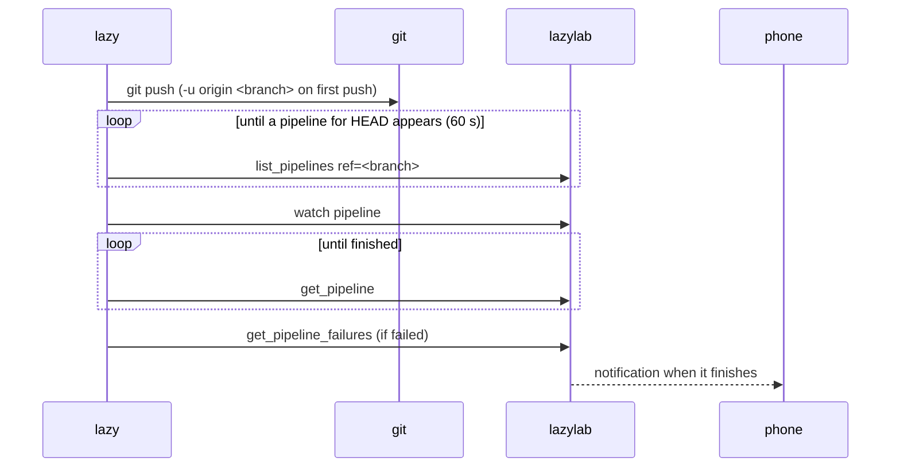

## Install

`lazy` ships in the repository as `cli/lazy.ts`. It needs no dependencies beyond Bun, or none at all as a compiled binary.

```bash
# Shell: bash, repository root. Build a standalone binary (includes the Bun runtime, about 95 MB).
bun run cli:build
install -m 755 dist-cli/lazy ~/.local/bin/lazy
```

Without building, run it through Bun:

```bash
# Shell: bash, any directory
alias lazy='bun /path/to/lazylab/cli/lazy.ts'
```

To build for another platform, pass a Bun target, for example `bun build cli/lazy.ts --compile --target=bun-darwin-arm64 --outfile dist-cli/lazy-macos`.

## Connect

Create an agent token in **Vault → Agent tokens**, then:

```bash
# Shell: bash, the machine you work on
lazy login https://lazylab.example.ts.net    # prompts for the llab_… token
```

`login` checks the token against `/mcp` and saves the URL and token to `~/.config/lazylab/cli.json` (or `$XDG_CONFIG_HOME/lazylab/cli.json`) with mode 600. `LAZYLAB_URL` and `LAZYLAB_TOKEN` override the file, for CI or a shell session.

The token acts as the active GitLab profile in lazylab, like any agent token. lazylab must be unlocked (signed in once since it started); otherwise `lazy` says so.

## Which project

`lazy` reads the project from the checkout it runs in:

1. `--project <group/project or id>`, when given;
2. `git config lazylab.project`, for checkouts whose remote is not GitLab;
3. the path of the `origin` remote (or the remote named in `git config lazylab.remote`). SSH, `ssh://` and HTTPS remotes are understood, including nested groups.

## Commands

| Command | Does |
|---|---|
| `lazy inbox [--refresh]` | MRs, issues and To-Dos that need you, grouped like the [inbox](/guide/inbox/) |
| `lazy brief issue\|mr <iid>` | Gather task context, patches, CI failures and recent handoffs |
| `lazy handoff list issue\|mr <iid> [--limit 5]` | Read saved checkpoints, newest first |
| `lazy handoff save issue\|mr <iid> --file handoff.json` | Save an encrypted checkpoint for the next agent or session |
| `lazy kb search <keywords> [--tag t] [--type bug\|gotcha\|perf] [--limit 5]` | Search shared findings across projects |
| `lazy kb show <entry-id>` | Read the full fix, tested environment and evidence |
| `lazy kb add --file finding.json` | Explicitly record a verified finding for this live GitLab project |
| `lazy kb confirm <entry-id> --note "checks and results"` | Confirm an existing fix after verifying it here |
| `lazy note add <title> [--body <text> \| --file notes.md] [--task] [--tag a,b]` | Jot down a personal note or task, encrypted in lazylab |
| `lazy note list [--kind note\|task] [--status open\|done\|migrated] [--tag t] [--search text] [--limit 50]` | Personal notes and tasks, newest change first |
| `lazy note show <id>` | One note with its body and comments; a unique prefix of 6+ characters works |
| `lazy note done\|reopen <id>` | Mark a task done, or open again |
| `lazy ci [--ref <ref>] [--all]` | The 10 most recent pipelines for the current branch |
| `lazy ci watch [<pipeline-id>]` | Follows a pipeline until it finishes: job starts and results, then the failure excerpt |
| `lazy job log <job-id>` | The failing section of one job log, with the error line and exit code |
| `lazy job log --failed [<pipeline-id>]` | Every failed job of the latest failed pipeline on the branch |
| `lazy retry <job-id> [--follow]` | Retries a job (lazylab watches the new one); `--follow` follows its pipeline |
| `lazy mr create [--draft] [--target <b>] [--title <t>] [--label a,b] [--watch]` | Opens an MR from the current branch |
| `lazy push [--detach] [-- <git push args>]` | `git push`, then follows the pipeline GitLab created for `HEAD` |
| `lazy env [--env <name>]` | The CI/CD variables that apply to the project, and where each comes from (no values) |
| `lazy env pull [--env <name>] [--out .env] [--force]` | Writes them to a `.env` file with mode 600 |
| `lazy run [--env <name>] -- <command>` | Runs a command with them in its environment; nothing is written to the project |

Common options: `--project`, `--json` (raw tool result for scripts), `--interval <seconds>` while following (default 5), `--no-notify`.

See [Task briefings and handoffs](/agents/handoffs/) for the JSON checkpoint format and a complete resume workflow.

The `note` commands work outside a checkout. See [Notes and tasks](/guide/notes/) for storage, migration and export.

The `kb` commands use the optional [BugKB connection](/agents/knowledge/). Search and show work outside a checkout; add and confirm require a live GitLab project.

### lazy push



- Without arguments, the branch is pushed under its own name and the upstream is set on the first push. A branch created from `origin/main` tracks `origin/main`; `lazy` treats it as not yet pushed.
- Arguments after `--` go to `git push` unchanged: `lazy push -- --force-with-lease`.
- `--detach` returns once the pipeline exists. lazylab keeps watching it and notifies you, so you can close the laptop.
- When no pipeline appears within 60 seconds (`--wait-pipeline <s>`), `lazy` stops and says so: the project may have no `.gitlab-ci.yml`, or its rules skip the push.
- Ctrl+C stops following; the lazylab watch stays.

### lazy mr create

The title is the last commit's subject, and the description is its body. A branch named `<number>-slug` or `type/<number>-slug` adds `Closes #<number>` unless the body already mentions the issue. `--draft` adds the `Draft:` prefix. The target is the project's default branch unless `--target` is given. The branch must be pushed first.

### Local environment: lazy env and lazy run

`lazy env pull` and `lazy run` give a local command the variables a CI job in the project would get, so the app runs against the same configuration without copying values out of GitLab by hand.

```bash
# Shell: bash, inside the project checkout
lazy env                                   # what applies, from where; no values printed
lazy run -- bun test                       # variables only in the test process's environment
lazy run --env staging -- bun run dev      # include variables scoped to the staging environment
lazy env pull --secret 'STRIPE_KEY=Stripe test key'   # .env with CI variables and one vault secret
```

These commands need an agent token created with **Can read secrets** ticked (Vault → Agent tokens). Other tokens get an error, and agents connected with them do not see the `get_env` tool.

Which variables apply follows GitLab's rules:

- Project variables win over group variables, and a subgroup's win over its parent's. Instance variables are left out.
- Without `--env`, only variables scoped to `*` apply, as for a job without `environment:`. With `--env production`, a variable scoped to `production` wins over one scoped to a pattern such as `prod*`, which wins over `*`.
- Protected variables are included. Choose the environment with that in mind.
- Hidden variables (masked and hidden, GitLab 17.4+) have no readable value. `lazy` uses the vault CI secret that was pushed to that key and scope when there is one, else reports the variable as missing.
- `--secret KEY=name` adds the generic vault secret with that entry name; without `KEY=` the name is converted, so `Stripe test key` becomes `STRIPE_TEST_KEY`. Several are comma-separated or repeated. These win over CI variables with the same key.
- File-type variables are written to a file, and the variable holds its path, as in CI: `<out>.d/<KEY>` for `env pull`, a private temporary directory for `run` (removed when the command exits).
- `$NAME` references inside values are not expanded.

Defaults for a checkout can live in git config:

```bash
# Shell: bash, inside the project checkout
git config lazylab.environment staging
git config --add lazylab.secret 'STRIPE_KEY=Stripe test key'
```

`lazy env pull` protects the file:

- It refuses to write a file that git does not ignore (and `.env.d/` when there are file variables). `--force` skips the check.
- It refuses to replace a `.env` it did not write. Files it writes start with `# Written by lazy env pull`.
- Values are single-quoted where needed, which Node's `--env-file`, dotenv and Docker Compose read literally. Bun's loader expands `$NAME` even inside single quotes; `lazy` lists the affected keys. Prefer `lazy run` when values must be exact.

`lazy run` passes Ctrl+C to the command and exits with the command's exit code. Each read is recorded in the lazylab journal with the token name, project and environment.

## Exit codes

| Code | Meaning |
|---|---|
| 0 | Done; a followed pipeline passed, is waiting for a manual job, or was skipped |
| n | `lazy run`: the command's own exit code (128 + signal number when it was killed by a signal) |
| 1 | Error, or a followed pipeline failed or was canceled |
| 2 | Usage error |
| 130 | Interrupted while following |

This makes `lazy push && deploy` and `lazy ci watch || lazy job log --failed` work as expected.

## How it talks to lazylab

Every command is one or more `tools/call` requests to lazylab's [MCP server](/agents/mcp/) with the agent token, so the CLI and agents use the same tools and permissions. `lazy ci watch` and `lazy push` poll `get_pipeline` every 5 seconds while following.
