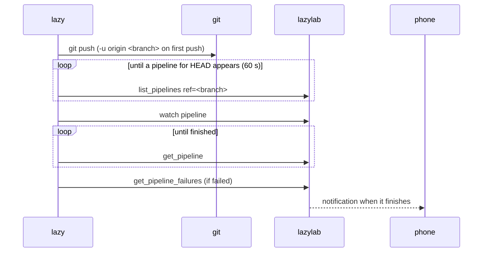

## Install

`lazy` ships in the repository as `cli/lazy.ts`. It needs no dependencies beyond Bun, or none at all as a compiled binary.

```bash
# Shell: bash, repository root. Build a standalone binary (includes the Bun runtime, about 95 MB).
bun run cli:build
install -m 755 dist-cli/lazy ~/.local/bin/lazy
```

Without building, run it through Bun:

```bash
# Shell: bash, any directory
alias lazy='bun /path/to/lazylab/cli/lazy.ts'
```

To build for another platform, pass a Bun target, for example `bun build cli/lazy.ts --compile --target=bun-darwin-arm64 --outfile dist-cli/lazy-macos`.

## Connect

Create an agent token in **Vault → Agent tokens**, then:

```bash
# Shell: bash, the machine you work on
lazy login https://lazylab.example.ts.net    # prompts for the llab_… token
```

`login` checks the token against `/mcp` and saves the URL and token to `~/.config/lazylab/cli.json` (or `$XDG_CONFIG_HOME/lazylab/cli.json`) with mode 600. `LAZYLAB_URL` and `LAZYLAB_TOKEN` override the file, for CI or a shell session.

The token acts as the active GitLab profile in lazylab, like any agent token. lazylab must be unlocked (signed in once since it started); otherwise `lazy` says so.

## Which project

`lazy` reads the project from the checkout it runs in:

1. `--project <group/project or id>`, when given;
2. `git config lazylab.project`, for checkouts whose remote is not GitLab;
3. the path of the `origin` remote (or the remote named in `git config lazylab.remote`). SSH, `ssh://` and HTTPS remotes are understood, including nested groups.

## Commands

| Command | Does |
|---|---|
| `lazy inbox [--refresh]` | MRs, issues and To-Dos that need you, grouped like the [inbox](/guide/inbox/) |
| `lazy ci [--ref <ref>] [--all]` | The 10 most recent pipelines for the current branch |
| `lazy ci watch [<pipeline-id>]` | Follows a pipeline until it finishes: job starts and results, then the failure excerpt |
| `lazy job log <job-id>` | The failing section of one job log, with the error line and exit code |
| `lazy job log --failed [<pipeline-id>]` | Every failed job of the latest failed pipeline on the branch |
| `lazy retry <job-id> [--follow]` | Retries a job (lazylab watches the new one); `--follow` follows its pipeline |
| `lazy mr create [--draft] [--target <b>] [--title <t>] [--label a,b] [--watch]` | Opens an MR from the current branch |
| `lazy push [--detach] [-- <git push args>]` | `git push`, then follows the pipeline GitLab created for `HEAD` |

Common options: `--project`, `--json` (raw tool result for scripts), `--interval <seconds>` while following (default 5), `--no-notify`.

### lazy push



- Without arguments, the branch is pushed under its own name and the upstream is set on the first push. A branch created from `origin/main` tracks `origin/main`; `lazy` treats it as not yet pushed.
- Arguments after `--` go to `git push` unchanged: `lazy push -- --force-with-lease`.
- `--detach` returns once the pipeline exists. lazylab keeps watching it and notifies you, so you can close the laptop.
- When no pipeline appears within 60 seconds (`--wait-pipeline <s>`), `lazy` stops and says so: the project may have no `.gitlab-ci.yml`, or its rules skip the push.
- Ctrl+C stops following; the lazylab watch stays.

### lazy mr create

The title is the last commit's subject, and the description is its body. A branch named `<number>-slug` or `type/<number>-slug` adds `Closes #<number>` unless the body already mentions the issue. `--draft` adds the `Draft:` prefix. The target is the project's default branch unless `--target` is given. The branch must be pushed first.

## Exit codes

| Code | Meaning |
|---|---|
| 0 | Done; a followed pipeline passed, is waiting for a manual job, or was skipped |
| 1 | Error, or a followed pipeline failed or was canceled |
| 2 | Usage error |
| 130 | Interrupted while following |

This makes `lazy push && deploy` and `lazy ci watch || lazy job log --failed` work as expected.

## How it talks to lazylab

Every command is one or more `tools/call` requests to lazylab's [MCP server](/agents/mcp/) with the agent token, so the CLI and agents use the same tools and permissions. `lazy ci watch` and `lazy push` poll `get_pipeline` every 5 seconds while following.
