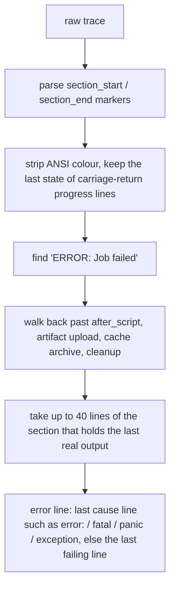

## The failure excerpt

Opening a failed job (from **CI/CD**, a notification, or **Why it failed**) shows the **Failure** tab first:

- the failure reason from GitLab with a short explanation;
- the exit code and the section the failure happened in;
- the error line;
- the last 40 lines of that section, with error lines highlighted and original line numbers;
- **likely passes on retry** for infrastructure failures;
- **Copy excerpt**, which copies plain text for a ticket or an agent prompt.

**Full log** shows the complete trace. lazylab keeps the last 2 MB of very large logs.

### How the excerpt is found

Retryable failure reasons: `runner_system_failure`, `stuck_or_timeout_failure`, `scheduler_failure`, `api_failure`, `data_integrity_failure`, `image_pull_failure`.

### Failed pipelines

Expanding a failed pipeline in **CI/CD** shows **Why it failed**: each failed job's name, stage, failure reason, exit code and error line, earliest stage first. Jobs with `allow_failure: true` are left out. **Excerpt** opens the job's failure view.

## Retry

- **Retry** on a failed or canceled job calls GitLab's `/jobs/:id/retry`. GitLab creates a new job; lazylab opens it and watches it.
- **Run** on a manual job calls `/jobs/:id/play`.
- **Retry** on a pipeline retries its failed jobs.

## Run a pipeline

**CI/CD → Run pipeline** opens a form with:

- **Project** and **Branch or tag**, with branch suggestions.
- **Variables:** the variables declared under `variables:` in `.gitlab-ci.yml` for that ref are filled in, with their descriptions and option lists, read through GitLab GraphQL `ciConfigVariables`. If GraphQL is unavailable, add rows by hand. Variables left at their declared default are not sent, so the config value applies.
- **Use last run:** the ref and variables you last used for this project, stored in this browser.
- **Notify me when it finishes:** on by default.

Variable values are visible to anyone who can see the pipeline. Use masked CI/CD variables for secrets.

## CI editor

**CI/CD → CI Editor** edits `.gitlab-ci.yml`:

- It loads the file from the project's default branch, or the branch typed in the commit bar after pressing the reload button. A branch without the file opens empty with a notice.
- The stage and job graph comes from a local parser. When you stop typing, validity is checked by GitLab's `POST /projects/:id/ci/lint`, which understands `include`, `extends` and `rules`. The status shows **Valid (GitLab)** or **Valid (local)**.
- **Commit** writes to the branch, creating it from the default branch if needed, and shows the commit id. Unchecking **Run pipeline** adds `[skip ci]` to the message.

## For agents

| MCP tool | REST |
|---|---|
| `get_pipeline_failures` | `GET /api/agent/pipelines/:id/failures?projectId=` |
| `get_job_failure` | `GET /api/agent/jobs/:id/failure?projectId=` |
| `run_pipeline` | `POST /api/agent/pipelines` |
| `retry_job` | none |
