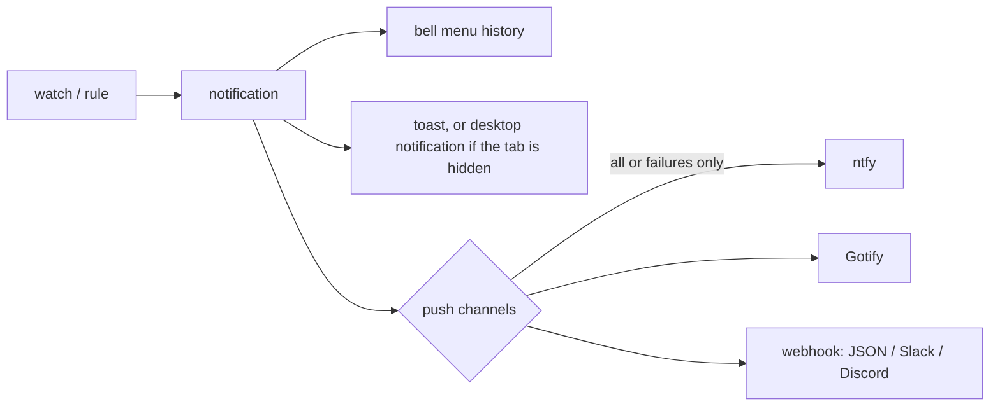

## Watches

A watch follows one item. lazylab polls every active watch every 15 seconds.

| Kind | Notifies when | Watch ends |
|---|---|---|
| Pipeline | it passes, fails, is canceled, is skipped, or stops at a manual job | at that point |
| Job | the same terminal states; failures include the runner's failure reason | at that point |
| Merge request | it gets merge conflicts; its head pipeline finishes | when merged or closed |

Ways to start one:

- the bell button on a running pipeline or job in **CI/CD**, or on an MR row in the **Inbox**;
- **Run pipeline** and **Retry** watch the new pipeline or job by default;
- agents: the `watch` MCP tool or `POST /api/agent/watches`.

Watches are stored in the vault per GitLab profile, survive restarts, and only run for the active profile. A watched item that returns `404` is removed with an info notification.

## Failure details

A failure notification includes the failing job and its error line, for example:

```text
Pipeline #30103 failed
k8s-operator · fix/eviction-deadlock
unit:concurrency: admission_test.go:88: fatal: deadlock detected on controller semaphore mutex
```

**Why it failed** in the bell menu, or a click on the desktop notification, opens the job's failure excerpt. See [CI failures](/guide/ci/).

## Rules

**Vault → Notifications → Rules** turns inbox and runner refreshes into notifications. All rules are on by default.

| Rule | Effect |
|---|---|
| Watch my MR pipelines | Running pipelines of MRs you authored are watched automatically |
| New review requests | A notification when you are added as a reviewer |
| New commits on MRs I review | A notification when the source branch of an MR you review gets a new head commit |
| Runner offline | A notification when one of your runners goes offline, and when it comes back |

The first refresh after sign-in is a silent baseline, so existing review requests do not all notify at once.

## Delivery



- **Bell menu:** the last 100 notifications and the active watches. The history is in memory and clears on restart or lock.
- **Desktop notifications:** click **Enable desktop notifications** in the bell menu. Browsers allow them only on HTTPS or `localhost`.
- **Push channels:** **Vault → Notifications → Add channel**. Each channel takes all events or failures only, has a **Test** button, and shows its last delivery or error. Tokens and webhook URLs are stored encrypted and shown masked.

| Channel | Fields | Request |
|---|---|---|
| ntfy | server URL, topic, optional access token | `POST <server>` with a JSON body; priority 4 for failures |
| Gotify | server URL, application token | `POST <server>/message` with `X-Gotify-Key` |
| Webhook | URL, format | `json`: the full notification; `slack`: `{"text": …}`; `discord`: `{"content": …}` |

### ntfy on a phone

1. Install the ntfy app and subscribe to a topic.
2. Add an ntfy channel with the same server and topic.
3. Press **Test**.

A topic on the public `ntfy.sh` server can be read by anyone who guesses its name. Use a long random topic, or a self-hosted server with an access token.

## Not yet supported

- Snoozing a watch, or setting quiet hours.
- Notifications for new approvals or comments on a watched MR.
- Keeping notification history across restarts.
