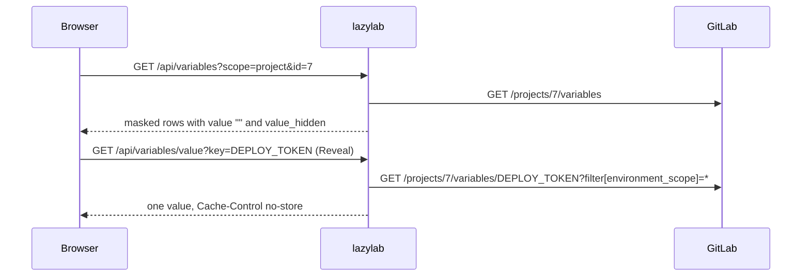

## General

- Description, topics, visibility and default branch are saved with `PUT /projects/:id`.
- The avatar uploads as a multipart file. GitLab accepts images up to 200 KB.

## CI/CD variables

**CI/CD → Variables** lists project variables and the variables of the project's parent group. Projects in a personal namespace have no group variables.

- Create, clone and delete variables. Saving a key that already exists in the same environment scope updates it. Variables can be protected, masked or raw, have an environment scope, and be of type file.
- **Bulk import** reads `KEY=value` lines (comments and blank lines are skipped) and saves each one.
- **Export** downloads or copies the visible variables as a `.env` file. Masked variables appear as a comment without their value.
- If the group's variables cannot be read, for example because you are not a maintainer of the group, the project's variables still show and a message names the failure.

### Masked values

The list response and the live update stream never contain masked values. **Reveal**, **Copy** and **Clone** fetch one value from `GET /api/variables/value`, which reads that single variable from GitLab, is not cached, and writes a `READ_VARIABLE` entry to the change journal.

## Badges

Project and group badges with link and image URLs. **Badges pipeline** sets up pipeline and coverage badges for `main` and `develop`, and pipeline and latest-release badges for tags. Image URLs point at the project's own GitLab instance (`<project>/badges/<ref>/pipeline.svg`, `<project>/-/badges/release.svg`). The preview shows the live badge; on a private project it only renders if this browser is signed in to GitLab.

## Pages

- Shows the Pages URL, last deployment time, HTTPS enforcement, access level and custom domains with certificate state.
- Values GitLab does not report show as "Not reported" or "Never".
- **Run Pages pipeline** starts a pipeline on the default branch and watches it. Pages deploys from that pipeline's `pages` job.
- **HTTPS only** toggles `pages_https_only`.

Reading Pages needs GitLab 16.8 or later.
