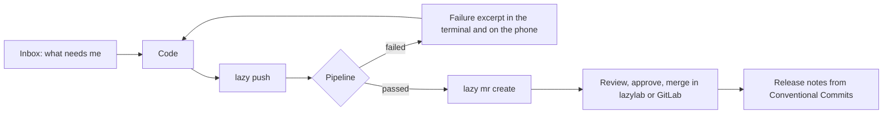
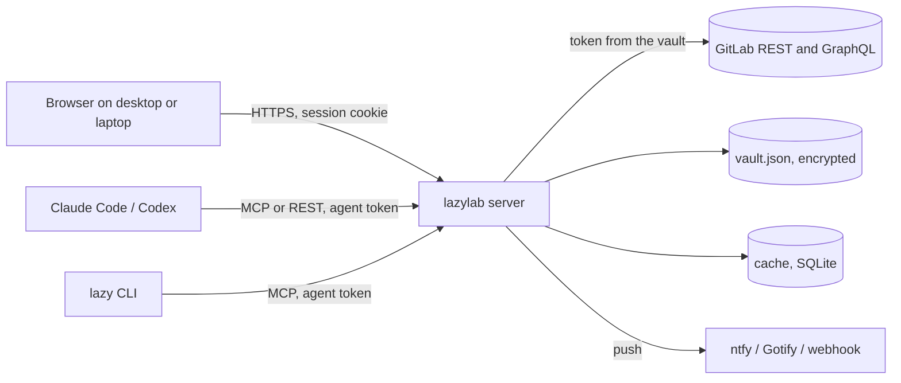

## What it does

lazylab sits between you and one or more GitLab instances. It runs as a single Bun process (or one container), serves a web UI, and exposes the same data to coding agents over MCP and REST and to your terminal through the `lazy` command.

| Area | What you get |
|---|---|
| Inbox | Merge requests and issues that need you across all member projects, with the reason: failed pipeline, conflicts, review requested, ready to merge |
| Notifications | Watches on pipelines, jobs and merge requests; push to your phone (ntfy, Gotify) or chat (Slack, Discord webhooks) |
| CI triage | The failing section of a job log, the error line and whether a retry is likely to help; run pipelines with variables |
| Planning | Work items, merge requests, milestones and labels, with comments and file attachments |
| Releases | Tags and releases, with notes generated from Conventional Commits and a suggested version |
| Project settings | CI/CD variables, badges, Pages, avatar, CI editor with GitLab lint |
| Vault | GitLab profiles, CI secrets, runner tokens, generic secrets and agent tokens, encrypted at rest; token expiry warnings |
| Command line | `lazy push` follows the pipeline after a push; `lazy run` gives local commands the project's CI/CD variables |
| Agents | An MCP server at `/mcp` and a REST API at `/api/agent`, both behind per-agent tokens |

## Why run it locally

GitLab's own UI already covers most single-project work. lazylab earns its place by doing what a hosted UI cannot, because it runs on your machine:

- **It sits next to your work.** The same host has your checkouts and your terminal, so `lazy` can find the project from the git remote and run your app with the project's variables.
- **It holds the secrets.** Your GitLab tokens stay in an encrypted vault. Agents, scripts and your laptop get revocable lazylab tokens instead of a GitLab token with `api` scope.
- **It looks across everything.** One inbox across every project you are a member of, instead of a tab per project.
- **It waits for you.** It watches pipelines and tokens and notifies your browser or phone, so you do not have to keep checking.

## A typical day

1. Open the [inbox](/guide/inbox/) to see which merge requests and issues are waiting on you.
2. Push with [`lazy push`](/cli/#lazy-push). It follows the pipeline in the terminal, and lazylab notifies your phone when it finishes.
3. If a job fails, the notification already names the failing job and error line. `lazy job log --failed` shows the excerpt; [CI failures](/guide/ci/) explains the triage view.
4. Open the merge request with `lazy mr create`, then review and merge from [Work items and merge requests](/guide/planning/).
5. Tag a release with notes generated from the commits since the last tag: [Releases and tags](/guide/releases/).

## How it fits together

[Architecture](/reference/architecture/) describes the components and the request path in detail.

## What it is not

- **Not a code review tool.** Diffs and line comments stay in GitLab's review UI; lazylab links to it and adds the queue, state and notifications around it.
- **Not a multi-user server.** lazylab has one owner and many devices. Anyone with the password or an agent token acts with your GitLab token.
- **Not finished.** It is pre-1.0. [Feature status](/reference/status/) lists what has been verified against a live GitLab instance and what has only run on demo data.

## Demo mode

With no GitLab profile active, lazylab serves a built-in sample dataset so you can explore the UI. Changes in demo mode live in memory and are lost on restart. The header shows `demo-mode` while it is active.

## Help

- Something not working: [FAQ and troubleshooting](/troubleshooting/).
- A bug or a missing feature: [open an issue](https://gitlab.com/sgkens/lazylab/-/issues).
