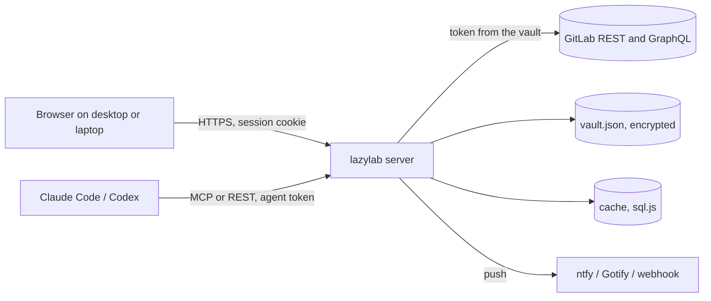

## What it does

lazylab sits between you and one or more GitLab instances. It runs as a single Bun process (or one container), serves a web UI, and exposes the same data to coding agents over MCP and REST.

| Area | What you get |
|---|---|
| Inbox | Merge requests and issues that need you across all member projects, with the reason: failed pipeline, conflicts, review requested, ready to merge |
| Notifications | Watches on pipelines, jobs and merge requests; push to your phone (ntfy, Gotify) or chat (Slack, Discord webhooks) |
| CI triage | The failing section of a job log, the error line and whether a retry is likely to help; run pipelines with variables |
| Planning | Work items, merge requests, milestones and labels, with comments and file attachments |
| Releases | Tags and releases, with notes generated from Conventional Commits and a suggested version |
| Project settings | CI/CD variables, badges, Pages, avatar, CI editor with GitLab lint |
| Vault | GitLab profiles, CI secrets, runner tokens, generic secrets and agent tokens, encrypted at rest |
| Agents | An MCP server at `/mcp` and a REST API at `/api/agent`, both behind per-agent tokens |

## How it fits together

## Where to start

1. [Getting started](/getting-started/): install, first-run setup, connect GitLab.
2. [Remote access](/remote-access/): use it from a laptop over HTTPS.
3. [Notifications and watches](/guide/notifications/): get told when CI finishes.
4. [MCP server](/agents/mcp/): connect Claude Code or Codex.

## Demo mode

With no GitLab profile active, lazylab serves a built-in sample dataset so you can explore the UI. Changes in demo mode live in memory and are lost on restart. The header shows `demo-mode` while it is active.
