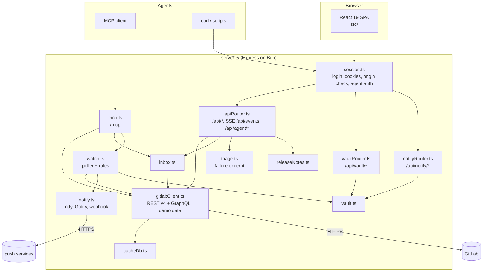
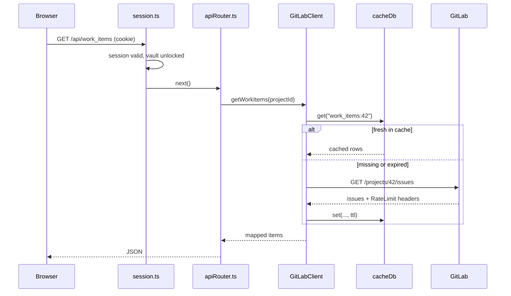
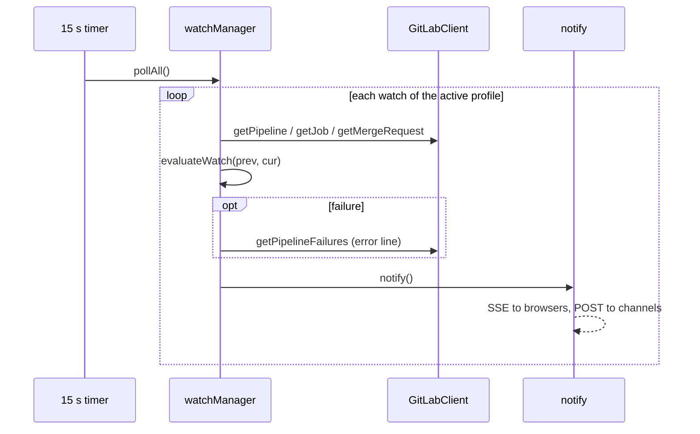

## Components

## Request path

- **Cache:** `bun:sqlite` in WAL mode at `lazylab_cache.sqlite`; each write is one row, and only recently used entries are held in memory. An append-only journal (`lazylab_journal.jsonl`) records changes. Entries have a TTL. Expired entries can still be read with `allowStale`. A database written by earlier versions (sql.js) opens as is; an unreadable file is moved aside and the cache starts empty.
- **All projects:** GitLab has no instance-wide list for pipelines, milestones, labels or packages. lazylab fans out over the 15 most recently active member projects, 4 requests at a time.
- **Live updates:** an auto-fetch timer (30 s by default) refreshes data. It pushes Server-Sent Events (`sync_completed`, `inbox_updated`, `notification`, `watches_changed`) to open browsers.

## Watch loop

`evaluateWatch` is a pure function, so the state machine is unit tested without GitLab.

## Lifecycle

| Event | Effect |
|---|---|
| Server start | Vault locked; GitLab client in demo mode; setup code printed if no vault exists |
| Sign-in | Vault unlocks; client rebuilt from the active profile; watch poller starts; auto-fetch runs |
| Profile switch | Client rebuilt; cache cleared; rule baselines reset |
| Lock or restart | Data key wiped; sessions cleared; poller stops; notification history cleared |

## Source layout

| Path | Contents |
|---|---|
| `server.ts` | Express setup, TLS, Vite middleware in development, static `dist/` in production |
| `server/` | Everything listed in the component diagram, plus `tls.ts`, `metricsManager.ts`, `yamlParser.ts`, `concurrency.ts` |
| `src/` | React 19 + Tailwind 4 SPA; `services/api.ts` is the only module that calls the server |
| `tests/` | `bun test` suites |
| `skills/` | Agent skills |
| `docs/` | This site (Eleventy) |
