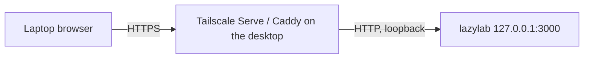

## Why HTTPS is required

Your password and session cookie cross the network on every sign-in and request. Over plain HTTP anyone on the path can read them. lazylab logs a warning at startup when it listens on a non-loopback address without TLS or a trusted proxy:

```text
WARNING: listening on a non-loopback address over plain HTTP. Passwords and session cookies are sent unencrypted.
```

Browsers also only allow desktop notifications on HTTPS pages (or `localhost`).

## Option A: Tailscale Serve or Caddy

Keep lazylab on loopback and let the proxy terminate HTTPS. This is the recommended setup: the certificate is trusted and nothing is exposed beyond the proxy.



`.env` on the desktop:

```bash
# Metal. For Docker, use the bridge range instead, e.g. 172.16.0.0/12
LAZYLAB_TRUST_PROXY=loopback
```

Shell: bash, on the desktop.

```bash
tailscale serve --bg 3000   # https://<desktop>.<tailnet>.ts.net -> http://127.0.0.1:3000
```

`LAZYLAB_TRUST_PROXY` makes lazylab honour `X-Forwarded-Proto`, so session cookies get the `Secure` flag.

### "Cross-origin request rejected"

Every write checks that the request's `Origin` matches the host it arrived on. If the proxy rewrites the `Host` header, saves fail with this message. Add the public name:

```bash
LAZYLAB_PUBLIC_HOSTS=desktop.tailnet-name.ts.net
```

## Option B: built-in HTTPS

`.env` on the desktop:

```bash
LAZYLAB_TLS=on
LAZYLAB_TLS_SANS=192.168.1.50,desktop.lan   # names and IPs the laptop will use
HOST=0.0.0.0                                # metal
LAZYLAB_BIND=0.0.0.0                        # Docker
```

- Without `LAZYLAB_TLS_CERT` and `LAZYLAB_TLS_KEY`, lazylab generates a self-signed certificate into `<data dir>/tls/` and logs its SHA-256 fingerprint. Compare it with the browser's certificate viewer on first connect.
- In Docker, `LAZYLAB_TLS_SANS` is required: the container hostname means nothing to the laptop.
- To avoid browser warnings, issue a certificate with [mkcert](https://github.com/FiloSottile/mkcert) for the desktop's names, trust mkcert's root CA on the laptop, and point `LAZYLAB_TLS_CERT` and `LAZYLAB_TLS_KEY` at the files.
- Delete `<data dir>/tls/` to regenerate the self-signed certificate after changing `LAZYLAB_TLS_SANS`.

## Agents on another machine

Node-based MCP clients such as Claude Code reject self-signed certificates. Use Option A, a trusted certificate, or point `NODE_EXTRA_CA_CERTS` at the certificate:

```bash
# Shell: bash, on the laptop; cert copied from <data dir>/tls/ on the desktop
export NODE_EXTRA_CA_CERTS="$HOME/.config/lazylab/cert.pem"
```
