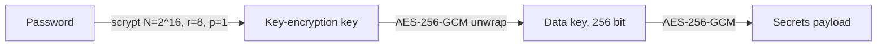

## Accounts and setup

- There is one admin account, created at first run.
- Creating it needs the setup code printed to the server log, so only someone with console or `docker logs` access can claim a new instance.
- Passwords must be at least 12 characters.
- After 4 failed sign-ins from one IP, each further attempt waits 2 s, 4 s, 8 s and so on, up to 15 minutes.

## The vault

- `vault.json` (file mode 0600) holds the scrypt parameters and salt, the data key wrapped with the password-derived key, and the payload encrypted with the data key.
- The payload holds:
  - GitLab profiles
  - CI secrets, runner tokens and generic secrets
  - agent token hashes
  - notification channels and rules
  - watches
- Every write uses a fresh IV, and both layers bind a purpose string as associated data.
- The data key exists only in memory, between a successful sign-in and a lock or process exit.
- After a restart the vault is locked. GitLab sync, watches and agent access stay paused until you sign in.
- **Vault → Account → Lock** wipes the key from memory and signs every device out.
- **A forgotten password means the vault contents are lost.** Changing the password re-wraps the data key; the secrets are not re-encrypted.

## Browser sessions

- Sessions are held in memory, so a restart signs everyone out.
- Session cookies are `HttpOnly` and `SameSite=Strict`. They also get `Secure` when the request arrived over HTTPS, directly or through a trusted proxy.
- Sessions expire after 12 hours idle or 7 days in total.
- Every write must carry an `Origin` (or `Referer`) whose hostname matches the request host or `LAZYLAB_PUBLIC_HOSTS`. This blocks cross-site request forgery.
- **Vault → Account** lists signed-in devices.

## Agent tokens

- Agent tokens (`llab_…`) are created in **Vault → Agent tokens**. They are shown once and stored only as a SHA-256 hash.
- A token authenticates `/api/agent/*` and `/mcp`. It does not open the vault or the browser UI.
- `/mcp` also rejects requests whose `Origin` header names a different host. This prevents DNS rebinding.
- Revoking a token takes effect on its next request.
- Tokens act as the GitLab profile that is active at the time. The one per-token right is **Can read secrets**, set at creation: only such tokens can call `get_env`, which returns CI/CD variable values and named vault secrets (for `lazy env pull` and `lazy run`). Give agents tokens without it. Each `get_env` call is written to the journal with the token name. Other scopes are planned.

## What is not encrypted

- The GitLab response cache (`lazylab_cache.sqlite` and `lazylab_journal.jsonl`). It holds issue, merge request and pipeline data, but no tokens. Switching or removing the active GitLab profile purges it; deleted rows are overwritten on disk (SQLite `secure_delete`). Expired rows are deleted after a grace period, see [Cache retention](/configuration/#cache-retention).
- Notification history is in memory only.
- Job logs and failure excerpts are fetched on demand and not stored.

## Sharing with other people

lazylab is built for one person. Anyone you give the password or an agent token to acts with your GitLab token.
